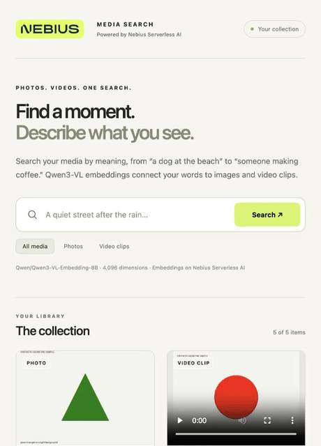

# Nebius Serverless cookbooks

Practical recipes for building AI applications with Nebius Serverless AI.

**Powered by Nebius Serverless AI**

## Cookbooks

| Cookbook | What you build | Tools |
| --- | --- | --- |
| [Build AI Search for Your Photos and Videos](photo-video-ai-search/README.md) | A persistent media gallery searchable by description, with playable video clips | Qwen3-VL Embedding, Qdrant, FastAPI |

## Start with media search

[Read the cookbook](photo-video-ai-search/README.md) for setup, code, a recorded preview, and validation notes.



[Watch the 12-second recording](photo-video-ai-search/docs/media/gallery-tour.mp4). This shows browsing and playback of previously indexed synthetic media; it shows no fresh search inference.

Run the recipe commands from its directory:

```bash
cd photo-video-ai-search
```

The GPU Endpoint computes embeddings on Nebius Serverless AI. The gallery and Qdrant run separately. Follow the cookbook for credentials, endpoint setup and cleanup.
