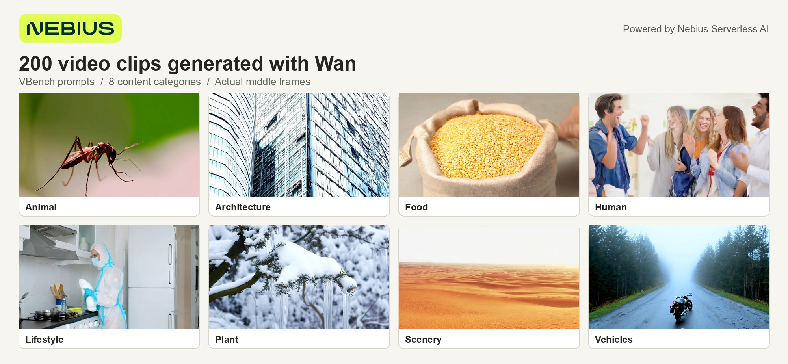

# Generate a Video Dataset with Wan

Generate 200 clips with Wan2.1-T2V-1.3B from published VBench video-generation prompts, 25 per content category. Review them in a gallery and use the manifest to trace every clip to its prompt, seed and settings. A repeatable prompt set helps you compare generation settings or model versions.

Nebius Serverless AI hosts Wan behind an authenticated Endpoint. Your computer submits prompts and saves each finished download. We’ll use a preemptible GPU with a price cap; saved clips remain on your computer if the GPU is reclaimed.



Powered by Nebius Serverless AI · [Saved clips](docs/sample-results) · [Recorded test runs](VALIDATION.md)

## 1. Set up

You need macOS or Ubuntu, Git, Python 3.10+, [Nebius CLI](https://docs.nebius.com/cli/install) 0.12.303+, and FFmpeg with `ffprobe`. Use a billing-enabled eu-north1 project with permission to create Endpoints and pricing policies, quota for a preemptible H100 and 500 GiB of disk, and an internet-enabled subnet. No local GPU is needed.

```bash
git clone https://github.com/MarouaneKhoukh/nebius-serverless-cookbooks.git
cd nebius-serverless-cookbooks/batch-video-generation
nebius profile create
```

Complete sign-in and choose your project. If already configured, use `nebius profile activate YOUR_PROFILE_NAME` instead. Run the remaining commands from this cookbook folder.

<details>
<summary>Install tools or create a subnet</summary>

Follow [CLI installation](https://docs.nebius.com/cli/install); run `nebius update` if it is older than 0.12.303. Install FFmpeg with `brew install ffmpeg` on macOS, or `sudo apt-get update && sudo apt-get install -y ffmpeg` on Ubuntu. If needed, [create a network and subnet](https://docs.nebius.com/vpc/networking/resources). Return to this folder after opening a new terminal.

</details>

Check the tools and bundled inputs without calling a model:

```bash
ffmpeg -version
ffprobe -version
python3 scripts/prepare_data.py --verify
python3 src/generate.py --check-input
```

Expect **200 prompts** and **49 frames at 832×480**. The [source selection and Apache 2.0 license](data/SOURCE.md) are included. This generates a review dataset, not a VBench score.

## 2. Start Wan with a price cap

In the [console](https://console.nebius.com), open Billing → Pricing → Pricing policy → Create pricing policy. Select your project and `gpu-h100-sxm`, check the current rate, and enter the maximum price per GPU hour you accept. A cap limits price exposure; it doesn’t guarantee capacity. [Pricing policy details](https://docs.nebius.com/signup-billing/manage-pricing-policy).

Copy the project ID from the project selector’s ⋯ menu → Copy project ID, the subnet ID from Networking → Virtual Networks → Subnets, and the new policy ID. Replace all three values:

```bash
cat > .env <<'ENV'
export NEBIUS_PROJECT_ID="YOUR_PROJECT_ID"
export NEBIUS_SUBNET_ID="YOUR_SUBNET_ID"
export SPOT_PRICING_POLICY_ID="YOUR_POLICY_ID"
ENV
source .env
```

The [configuration](config/endpoint.json) uses vLLM-Omni 0.24.0, one H100 and a 500 GiB temporary disk. Wan is public; no Hugging Face token is needed. You pay for compute used to pull the image and load the model, plus idle time. The disk is billed separately.

The first command validates the configuration; the second creates the Endpoint; the last waits for the model:

```bash
python3 scripts/endpoint.py create \
  --project-id "$NEBIUS_PROJECT_ID" --subnet-id "$NEBIUS_SUBNET_ID" \
  --spot-pricing-policy-id "${SPOT_PRICING_POLICY_ID:?Set SPOT_PRICING_POLICY_ID}" \
  --name wan-video-dataset --dry-run &&
python3 scripts/endpoint.py create \
  --project-id "$NEBIUS_PROJECT_ID" --subnet-id "$NEBIUS_SUBNET_ID" \
  --spot-pricing-policy-id "${SPOT_PRICING_POLICY_ID:?Set SPOT_PRICING_POLICY_ID}" \
  --name wan-video-dataset --yes &&
python3 scripts/endpoint.py wait --timeout 1800
```

Proceed at **Model API ready**. The helper keeps the Endpoint selection in `.state/` and passes its URL and token privately to the client. A timeout doesn’t stop compute; inspect Endpoint logs and stop it while diagnosing. In a new terminal, return here and run `source .env`.

For uncapped pricing, omit `--spot-pricing-policy-id` from both create commands. The helper then follows the spot price, which can exceed the regular rate.

## 3. Generate and review 200 clips

Keep this computer awake and connected: it sends each prompt and downloads each clip. On an automated runner, use persistent storage for the output folder. Full-batch duration has not been measured; [validation](VALIDATION.md) records partial generation and saved-file recovery.

```bash
python3 scripts/endpoint.py run -- \
  python3 src/generate.py --input data/prompts.csv --output results-vbench-200 &&
python3 scripts/check_results.py results-vbench-200
```

For a new folder, expect **Generated 200; reused 0**, then **"completed": 200** and **"decode_passed": true**. Each clip is 49 frames at 16 fps, about 3.06 seconds, at 832×480. The checker validates hashes, metadata and MP4 decoding.

Open `results-vbench-200/index.html` with `open results-vbench-200/index.html` on macOS, or `xdg-open results-vbench-200/index.html` on Ubuntu. Expect **200 of 200 clips saved**. Play the clips, review prompt alignment and follow the source links. The folder also contains ordinary MP4s, `clips.csv`, per-clip JSON and input provenance.

### Use your own prompts

Keep Wan running. Replace these rows with your prompt catalog; use unique IDs, integer seeds from 0 to 2147483647, and quotes around descriptions containing commas. The client accepts up to 1,000 prompts per CSV.

```bash
cat > data/my-prompts.csv <<'CSV'
id,prompt,seed
coffee,"Steam rising from a cup of coffee in soft morning light",42
coast,"A slow aerial shot of waves breaking along a rocky coastline",43
CSV
python3 src/generate.py --input data/my-prompts.csv --check-input &&
python3 scripts/endpoint.py run -- \
  python3 src/generate.py --input data/my-prompts.csv --output results-custom &&
python3 scripts/check_results.py results-custom
```

Open `results-custom/index.html` the same way. Use a new output folder when changing prompts, seeds or settings.

## 4. Stop the Endpoint

```bash
python3 scripts/endpoint.py stop
python3 scripts/endpoint.py status
```

Expect **STOPPED**. The GPU and temporary disk are released; downloaded results remain. Closing the client or gallery doesn’t stop billing. Keep shared networking in place.

## What if your workload is interrupted?

**Finished clips and their completion records stay on your computer, outside the Endpoint.** Keep the whole output folder, including its JSON records and `.pending` directory, plus the helper’s `.state/` folder. Rerunning the same command skips completed clips and finishes the batch; an unfinished clip may need regeneration.

- Keep the input, model settings and output folder unchanged.
- Use one generation process per folder.
- Use `python3 scripts/endpoint.py status` to choose the recovery case below.
- After recovery, validate all clips and stop the Endpoint as in step 4.

### The client stopped

Run `python3 scripts/endpoint.py status`. If it shows **RUNNING**, rerun the generation command from step 3 without `--retry-lost`. The client checks its saved request IDs, continues pending requests and skips finished downloads.

### The GPU was reclaimed

If status shows **STOPPED**, start the Endpoint and wait for Wan:

```bash
python3 scripts/endpoint.py start
python3 scripts/endpoint.py wait --timeout 1800
```

Check the saved request by rerunning the original command:

```bash
python3 scripts/endpoint.py run -- \
  python3 src/generate.py --input data/prompts.csv --output results-vbench-200
```

If it reports “server no longer has this request” or “submission outcome or Endpoint changed”, it stopped before submitting a replacement. If you connected to a replacement Endpoint, confirm the previous Endpoint is STOPPED in the console. Then use `--retry-lost` to allow a new paid request for unfinished work:

```bash
python3 scripts/endpoint.py run -- \
  python3 src/generate.py --input data/prompts.csv --output results-vbench-200 --retry-lost &&
python3 scripts/check_results.py results-vbench-200
```

Then run the two stop/status commands in step 4 and confirm **STOPPED**. If capacity is unavailable, try starting later.

### Try it yourself

Use a new folder. Start and wait as above, then limit the first client run to 20 finished downloads:

```bash
python3 scripts/endpoint.py run -- \
  python3 src/generate.py --input data/prompts.csv --output results-resume-test --limit 20
```

Expect **Generated 20; reused 0**. Resume without the limit:

```bash
python3 scripts/endpoint.py run -- \
  python3 src/generate.py --input data/prompts.csv --output results-resume-test &&
python3 scripts/check_results.py results-resume-test
```

Expect **Generated 180; reused 20** and 200 valid clips. This is a deliberate client stop, not a preemption. Finish with step 4 and confirm **STOPPED**. For local checks, run `python3 -m unittest discover -s tests`; see [VALIDATION.md](VALIDATION.md) for execution records.

## Run with an agent

Install the [Nebius skills](https://github.com/nebius/skills#install), share this cookbook and ask:

```text
Run batch-video-generation with nebius-cloud-basics and
nebius-serverless-endpoints in my selected project and subnet, within
my approved GPU budget. Use config/endpoint.json and a price-capped
preemptible Endpoint. Wait for Model API ready; generate all 200 clips.
Require scripts/check_results.py to pass with 200 decoded clips, review
the gallery, stop the Endpoint and confirm STOPPED. Report failures.
Keep credentials private; preserve my results and other resources.
```
