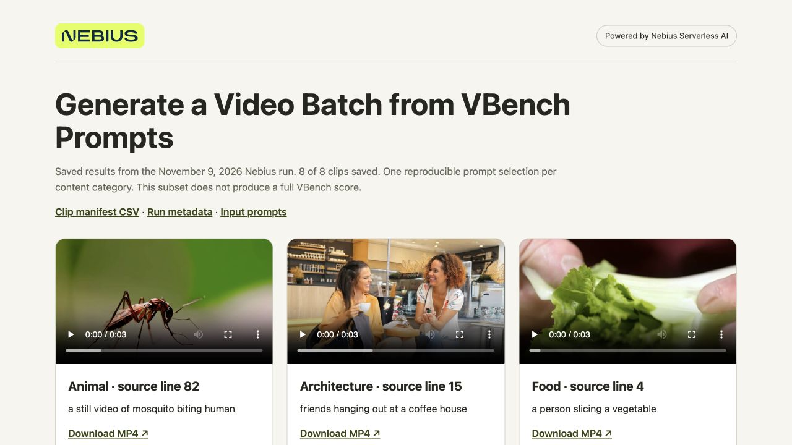

# Generate Video Clips from a List of Prompts

Run **Wan2.1-T2V-1.3B** on eight published **VBench prompts**, one from each content category. Get eight MP4s, a source-linked CSV manifest and a local gallery. A fixed prompt selection and recorded seeds let you repeat the batch when testing a model or changing generation settings.

**Nebius Serverless AI hosts Wan behind an Endpoint**, an authenticated model API on a cloud GPU. Your computer submits requests and saves each finished clip. **Preemptible GPUs** offer a lower rate when capacity is available, with the trade-off that Nebius can reclaim them. Finished downloads remain reusable; an unfinished generation may need another request.

These are public benchmark prompts, not production footage. This small batch doesn't calculate a VBench score. [Prompt source, selection and Apache 2.0 license](data/SOURCE.md).



**Powered by Nebius Serverless AI**

[Saved clips and manifests](docs/sample-results) · [Measured run](VALIDATION.md)

## What you need

- macOS or Ubuntu, Git and Python **3.10+**. No local GPU or extra Python packages.
- A billing-enabled Nebius project in **eu-north1**, with permission and quota for **one preemptible H100**.
- FFmpeg and `ffprobe` to validate downloads.

## 1. Get the files

```bash
git clone https://github.com/MarouaneKhoukh/nebius-serverless-cookbooks.git
cd nebius-serverless-cookbooks/batch-video-generation
```

Run all commands from this directory. Install FFmpeg with `brew install ffmpeg` on macOS with [Homebrew](https://brew.sh/), or on Ubuntu:

```bash
sudo apt-get update
sudo apt-get install -y ffmpeg
```

Check the bundled inputs without a cloud account:

```bash
ffmpeg -version
ffprobe -version
python3 scripts/prepare_data.py --verify
python3 src/generate.py --check-input
```

Expect **eight prompts** and **49 frames at 832×480**. The CSV includes the original category, source line, pinned VBench revision and a video seed. Its matching `.source.json` records the source checksums and selection.

## 2. Sign in and choose a network

Install the Nebius CLI if needed:

```bash
curl -sSL https://artifacts.nebius.cloud/cli/install.sh | bash
```

Open a new terminal and return to this directory. Use CLI **0.12.303+**; run `nebius update` if yours is older. Copy your project ID from the [console](https://console.nebius.com), replace the placeholder and complete browser sign-in:

```bash
export AI_AGENT="${AI_AGENT:-cookbook}"
nebius version
export NEBIUS_PROJECT_ID="YOUR_PROJECT_ID"
nebius profile create cookbook --parent-id "$NEBIUS_PROJECT_ID"
nebius profile activate cookbook
nebius iam whoami
```

If already signed in to this project, activate that profile instead of creating `cookbook`.

Choose a **subnet**, the Endpoint's network, with outbound internet access for model downloads. Copy its `metadata.id`:

```bash
nebius vpc subnet list --parent-id "$NEBIUS_PROJECT_ID" --format json
export NEBIUS_SUBNET_ID="YOUR_SUBNET_ID"
```

If the project has no subnet, create one with the default internet route:

```bash
export NEBIUS_NETWORK_ID="$(nebius vpc network create --parent-id "$NEBIUS_PROJECT_ID" --name cookbook-network --format jsonpath='{.metadata.id}')"
export NEBIUS_SUBNET_ID="$(nebius vpc subnet create --parent-id "$NEBIUS_PROJECT_ID" --name cookbook-subnet --network-id "$NEBIUS_NETWORK_ID" --format jsonpath='{.metadata.id}')"
```

## 3. Start Wan

The [configuration](config/endpoint.json) uses **vLLM-Omni 0.24.0**, one H100 and a **500 GiB temporary disk**. The model is public; no Hugging Face token is required.

Check the rate under **Serverless AI → Endpoints → Create endpoint → Preemptible**. The helper follows the changing spot price without a cap; it can exceed the regular rate. Image/model loading and idle time use paid compute. A pricing policy can set a maximum; create one for `gpu-h100-sxm` under **Billing → Pricing → Pricing policy** and add `--spot-pricing-policy-id "YOUR_POLICY_ID"` to both commands below if needed.

During this experiment, the H100 and disk were quoted at **about $0.85/hour before tax**. That's an hourly quote, not a cost per clip.

```bash
python3 scripts/endpoint.py create \
  --project-id "$NEBIUS_PROJECT_ID" --subnet-id "$NEBIUS_SUBNET_ID" \
  --name cookbook-video-generation --dry-run

python3 scripts/endpoint.py create \
  --project-id "$NEBIUS_PROJECT_ID" --subnet-id "$NEBIUS_SUBNET_ID" \
  --name cookbook-video-generation --yes

python3 scripts/endpoint.py wait --timeout 1800
```

Wait for the model API readiness message. The helper passes the URL and token privately to client commands. A wait timeout doesn't stop the Endpoint: inspect logs and stop unused compute while diagnosing.

<details>
<summary>Run with an agent instead</summary>

Install the [Nebius skills](https://github.com/nebius/skills#install) for an agent with terminal access and the signed-in CLI, then paste:

```text
Run batch-video-generation in MarouaneKhoukh/nebius-serverless-cookbooks.
Use nebius-cloud-basics and nebius-serverless-endpoints in project
<PROJECT_ID> and subnet <SUBNET_ID>. Follow config/endpoint.json.
Verify the VBench source selection. Show the current price and confirm
before launching unapproved compute. Generate all eight 49-frame clips,
check them with scripts/check_results.py, rerun to verify completed-clip
reuse, then stop this Endpoint and verify STOPPED. Keep tokens private.
```

</details>

## 4. Generate the batch

First generate two clips, then run the same input again to complete the batch:

```bash
python3 scripts/endpoint.py run -- \
  python3 src/generate.py --input data/prompts.csv --output results-vbench --limit 2

python3 scripts/endpoint.py run -- \
  python3 src/generate.py --input data/prompts.csv --output results-vbench

python3 scripts/check_results.py results-vbench
```

The second process reuses the two completed downloads and generates six more. Each output is **49 frames at 16 fps**, about **3.06 seconds**, at **832×480**, using 20 inference steps. The checker verifies input joins, provenance, hashes and MP4 decoding. These are short previews for inspection.

## 5. Inspect and reuse the output

Open **`results-vbench/index.html`**. Check **8 of 8 clips saved**, play the clips and inspect how well each follows its original prompt. Every card links to the exact VBench source line.

- **`clips.csv`** joins prompt IDs, categories, seeds, source links, clip filenames and hashes.
- **`summary.json`** records settings and completion; each clip also has its own JSON record.
- **`input.csv`**, **`input.source.json`** and the dataset license retain input provenance.
- **MP4 files** are ordinary downloads you can use in your own UI; the branded gallery is a preview.

Rerun the generation command once more. Expect **Generated 0; reused 8**, without new generation requests. [Validation and measured output](VALIDATION.md) record which checks were actually performed; this recipe does not run the full VBench evaluation protocol.

## 6. Stop or resume

Stop when finished and verify **STOPPED**:

```bash
python3 scripts/endpoint.py stop
python3 scripts/endpoint.py status
```

The GPU and temporary disk are released; downloaded results remain. Closing the gallery or client alone doesn't stop billing.

If only the client stopped, rerun the original command first: it can continue polling an existing request. After a confirmed GPU interruption, restart the Endpoint and explicitly allow replacement of lost requests:

```bash
python3 scripts/endpoint.py start
python3 scripts/endpoint.py wait --timeout 1800
python3 scripts/endpoint.py run -- \
  python3 src/generate.py --input data/prompts.csv --output results-vbench --retry-lost
python3 scripts/endpoint.py stop
python3 scripts/endpoint.py status
```

**`--retry-lost` permits another paid request.** Check the old request and Endpoint before using it. Completed downloads are skipped. Keep the input, settings and output directory unchanged; changing them requires a new directory.

## Use a larger batch or your own prompts

The eight prompt lists contain 800 prompts. To prepare five per category, with recorded source IDs and seeds:

```bash
python3 scripts/prepare_data.py --per-category 5 --output data/larger-batch.csv
```

This prepares 40 inputs, without launching compute. Keep its `larger-batch.source.json` beside the CSV. Use `--input data/larger-batch.csv --output results-larger` in the generation command. More clips mean more paid inference.

For your own inputs, use a UTF-8 CSV with `id,prompt,seed`; IDs must be unique and filename-safe. The VBench columns are optional for custom inputs. Keep model settings and inputs fixed when comparing runs.

For quota errors, check **Quotas**. For capacity errors, retry when preemptible H100s are available. For API or decode failures, inspect logs and stop unused compute; failed downloads are not marked complete.

Local checks, without cloud resources:

```bash
python3 -m unittest discover -s tests -v
```

[VBench source and license](data/SOURCE.md) · [Nebius Wan template](https://github.com/nebius/serverless-ai-cookbook/tree/main/templates/endpoint-wan21-t2v-1-3b) · [Pricing policies](https://docs.nebius.com/signup-billing/manage-pricing-policy)
