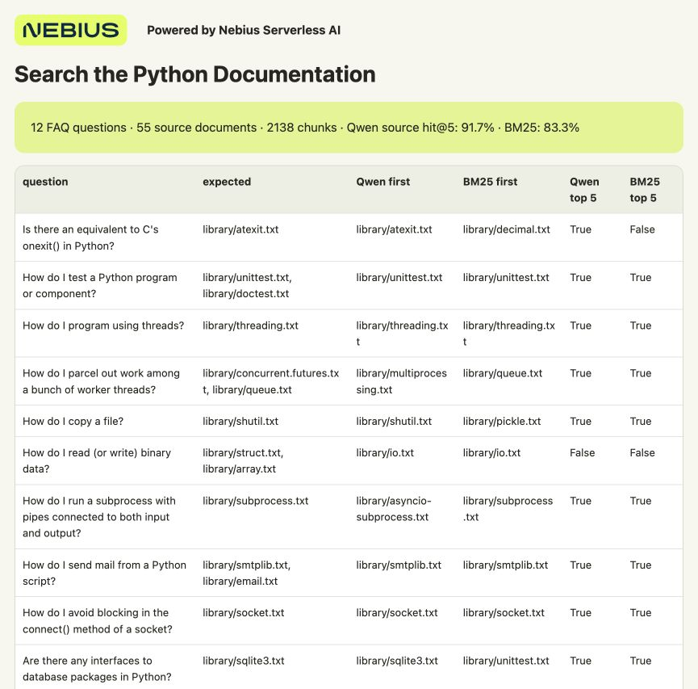

# Search the Python Docs by Meaning

This is the separate Serverless Endpoint route: 55 Python documents, indexed from your computer. For the Serverless Job route and its 1,000-document search index, use [README.md](README.md).

Search **55 real Python standard-library reference documents** with Qwen3-Embedding-0.6B. You'll save **2,138 passage embeddings**, ask a question and inspect the sources in a browser report. Twelve original Python FAQ questions let you compare semantic retrieval with a CPU keyword baseline.

Nebius Serverless AI hosts Qwen behind an **Endpoint**, an authenticated HTTPS model API. Your computer prepares the documents, saves vectors and searches them. No local GPU or vector database is required.

A **preemptible GPU** can offer a lower rate, but Nebius can reclaim it. Saved passage vectors survive on your computer, so indexing can continue later. New questions need the model Endpoint available; already saved reports open without it.

## What you need

- macOS or Ubuntu, Git and **Python 3.10+**. The local tools use Python's standard library.
- A billing-enabled Nebius project in **eu-north1**, permission to create Endpoints and quota for **one preemptible L40S**.

## 1. Get the files and real corpus

```bash
git clone https://github.com/MarouaneKhoukh/nebius-serverless-cookbooks.git
cd nebius-serverless-cookbooks/document-search
python3 scripts/prepare_data.py
```

Run all remaining commands from this directory. Preparation downloads the official **Python 3.13.9** text archive, verifies its checksum and the selected files, and retains the PSF license. The result is 55 documents in `data/documents/`. [Data provenance and license](data/SOURCE.md).

Try the CPU baseline before renting a GPU:

```bash
python3 scripts/run_baseline.py --output-dir results-bm25
```

Open `results-bm25/report.html`. BM25 searches the same chunks by words. If it meets your needs, use it; the GPU path lets you compare a semantic model on these same questions.

## 2. Sign in to Nebius

Install the CLI if needed:

```bash
curl -sSL https://artifacts.nebius.cloud/cli/install.sh | bash
```

Open a new terminal and return to this directory. Use CLI **0.12.303+**; run `nebius update` if yours is older. Copy your project ID from the [console](https://console.nebius.com), replace the placeholder and complete browser sign-in:

```bash
export AI_AGENT="${AI_AGENT:-cookbook}"
nebius version
export NEBIUS_PROJECT_ID="YOUR_PROJECT_ID"
nebius profile create cookbook --parent-id "$NEBIUS_PROJECT_ID"
nebius profile activate cookbook
nebius iam whoami
```

Already signed in to this project? Activate that profile instead of creating `cookbook`.

Choose a **subnet**, the Endpoint's network, with outbound internet access for model downloads. Copy its `metadata.id`:

```bash
nebius vpc subnet list --parent-id "$NEBIUS_PROJECT_ID" --format json
export NEBIUS_SUBNET_ID="YOUR_SUBNET_ID"
```

<details>
<summary>If the project has no subnet</summary>

```bash
export NEBIUS_NETWORK_ID="$(nebius vpc network create --parent-id "$NEBIUS_PROJECT_ID" --name cookbook-network --format jsonpath='{.metadata.id}')"
export NEBIUS_SUBNET_ID="$(nebius vpc subnet create --parent-id "$NEBIUS_PROJECT_ID" --name cookbook-subnet --network-id "$NEBIUS_NETWORK_ID" --format jsonpath='{.metadata.id}')"
```

New networks have a default internet route. Use an approved subnet if your company manages networking.

</details>

## 3. Start the embedding model

The [configuration](config/endpoint.json) uses **Qwen/Qwen3-Embedding-0.6B**, the vLLM **0.19.1** pooling runner, one L40S and a **500 GiB temporary disk**. The model is public; no Hugging Face token is required.

Check the rate under **Serverless AI → Endpoints → Create endpoint → Preemptible**. L40S currently has a [flat preemptible rate](https://nebius.com/prices), although the CLI calls its setting **Follow Spot price**. Model loading and idle time are billable.

Preview, create and wait for the model API:

```bash
python3 scripts/endpoint.py create \
  --project-id "$NEBIUS_PROJECT_ID" --subnet-id "$NEBIUS_SUBNET_ID" \
  --name cookbook-python-doc-search --dry-run

python3 scripts/endpoint.py create \
  --project-id "$NEBIUS_PROJECT_ID" --subnet-id "$NEBIUS_SUBNET_ID" \
  --name cookbook-python-doc-search --yes

python3 scripts/endpoint.py wait --timeout 1800
```

The helper passes the Endpoint URL and token privately to client commands. If readiness times out, inspect Endpoint logs and stop unused compute.

<details>
<summary>Reuse an existing embedding Endpoint</summary>

Instead of creating one, copy the ID of a preemptible Endpoint serving this exact embedding model with the pooling runner:

```bash
python3 scripts/endpoint.py attach --project-id "$NEBIUS_PROJECT_ID" --id YOUR_ENDPOINT_ID
python3 scripts/endpoint.py wait --timeout 1800
```

A chat model Endpoint cannot create the required embedding vectors.

</details>

<details>
<summary>Run with an agent</summary>

Install the [Nebius skills](https://github.com/nebius/skills#install) for an agent with terminal access and the signed-in CLI, then paste:

```text
Run document-search in MarouaneKhoukh/nebius-serverless-cookbooks.
Use nebius-cloud-basics and nebius-serverless-endpoints in project
<PROJECT_ID> and subnet <SUBNET_ID>. Follow config/endpoint.json.
Prepare the pinned Python corpus. Show the price and confirm before
launching unapproved compute. Index all 2,138 chunks, verify saved
results, compare the 12 FAQ queries with BM25, then stop only this
Endpoint and verify STOPPED. Keep tokens private.
```

</details>

## 4. Save the document vectors

```bash
python3 scripts/endpoint.py run -- \
  python3 src/embed.py index --input-dir data/documents \
  --output-dir results --batch-size 16

python3 scripts/check_result.py --input-dir data/documents --output-dir results
```

Expect **55 documents, 2,138 saved chunks and 1,024 dimensions**. Each completed chunk is saved independently on your computer. The checker verifies IDs, source text, vector/metadata alignment and the retained license.

`vectors.jsonl` and `metadata.jsonl` are the reusable collection. Keep them together. The HTML is only a report view; you can use the exported data with your own interface or vector database.

## 5. Search and compare

```bash
python3 scripts/endpoint.py run -- \
  python3 src/embed.py query --output-dir results \
  --text "How do I copy a file?" --top-k 5
```

Open **`results/search.html`** and follow a source link to read the original reference. A similarity score expresses closeness, not the probability that a passage answers the question.

Run all twelve FAQ checks against Qwen and BM25:

```bash
python3 scripts/endpoint.py run -- \
  python3 src/embed.py check --output-dir results \
  --queries data/queries.json --top-k 5

python3 scripts/check_result.py --input-dir data/documents \
  --output-dir results --require-checks
```

Open **`results/retrieval-checks.html`**. The report shows both methods' ranked source documents and source hit rates. The FAQ answers are excluded from the index. Expected sources are curated from the FAQ's reference modules; these are diagnostic checks, not a blind benchmark or exhaustive relevance judgments. Inspect passages before choosing a search method. [Validation notes](ENDPOINT_VALIDATION.md).



**Powered by Nebius Serverless AI**

In the [recorded checks](docs/sample-results/), an expected reference appeared among the first five chunks for **11/12 questions with Qwen** and **10/12 with BM25**. These counts apply to the curated source checks above; inspect the returned passages as well.

## 6. Resume or stop

To check saved progress deliberately, use a new output directory and add `--limit-chunks 64` to the index command. Repeat the command without that limit: it should reuse 64 chunks and finish 2,074. Rerunning a complete index sends no new document-embedding requests.

After an actual interruption, keep the original documents, settings and output directory. When capacity is available, explicitly start the Endpoint, wait, then repeat indexing:

```bash
python3 scripts/endpoint.py start
python3 scripts/endpoint.py wait --timeout 1800
python3 scripts/endpoint.py run -- \
  python3 src/embed.py index --input-dir data/documents --output-dir results --batch-size 16
```

An unfinished chunk may run again. Finish the collection before querying. A new question needs the Endpoint running.

Stop when finished, including after retries:

```bash
python3 scripts/endpoint.py stop
python3 scripts/endpoint.py status
```

Verify **STOPPED** to release the GPU and temporary disk. Local vectors and reports remain. Until stopped, the Endpoint stays billable between requests.

## Use your own documents

Use UTF-8 `.txt` or `.md` files, up to 5 MiB each, in a separate folder and change `--input-dir`. Extract PDF text first. Choose a new output directory when changing documents, chunking or model settings. The included source checks apply only to the pinned Python corpus.

For quota or capacity errors, check the console and retry when capacity is available. For changed-file errors, restore the original corpus with `scripts/prepare_data.py` or use a new input/output directory. Local checks create no cloud resources:

```bash
python3 -m unittest discover -s tests -q
```
