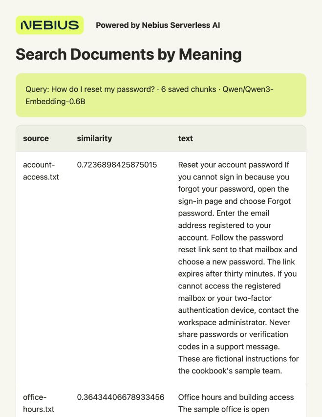

# Search Documents by Meaning

Build a small search tool for a folder of text documents. Qwen turns the text into **embeddings**, lists of numbers that represent its meaning. You'll save those embeddings, ask a question and see the closest matching documents in a browser report. Six example documents are included.

Nebius Serverless AI runs Qwen on a cloud GPU, so you don't need to configure a GPU server. You'll create an **Endpoint**, a model API you call over HTTPS. Your computer stores the document text, embeddings and search results.

**Preemptible instances give you a way to do more with your GPU budget.** They provide GPU capacity at a changing market price that can be lower than the regular rate. The trade-off is that a run can be interrupted. This cookbook saves each completed chunk on your computer, so you can resume indexing and process only the unfinished text.

For example, during this experiment, this setup was priced at about **$0.80/hour on preemptible compute, compared with $1.60/hour on regular compute**. Prices can change.



**Powered by Nebius Serverless AI**

## What you need

- macOS or Ubuntu, Git and Python **3.10+**. No local GPU, database or extra Python packages.
- A Nebius account with billing enabled and a project in **eu-north1**. A project holds your cloud resources and their permissions.
- Permission and quota to run **one preemptible L40S GPU**. Quota is your account's resource allowance; check **Quotas** in the console if deployment is refused.

## 1. Get the files

```bash
git clone https://github.com/MarouaneKhoukh/nebius-serverless-cookbooks.git
cd nebius-serverless-cookbooks/document-search
python3 --version
```

Run the remaining commands from this directory.

## 2. Sign in to Nebius

The Nebius CLI creates and manages your Endpoint from the terminal. If it isn't installed:

```bash
curl -sSL https://artifacts.nebius.cloud/cli/install.sh | bash
```

Open a new terminal after installation and return to this cookbook's directory. Use CLI **0.12.303 or newer**; run `nebius update` if yours is older.

In the [Nebius console](https://console.nebius.com), select your eu-north1 project and copy its project ID. Replace the **entire** `YOUR_PROJECT_ID` value:

If you already have a signed-in CLI profile for this project, use its name in place of `cookbook` and skip `profile create`. Otherwise, create the `cookbook` profile:

```bash
nebius version
export NEBIUS_PROJECT_ID="YOUR_PROJECT_ID"
export AI_AGENT="${AI_AGENT:-cookbook}"
nebius profile create cookbook --parent-id "$NEBIUS_PROJECT_ID"
nebius profile activate cookbook
nebius iam whoami
```

Complete the browser sign-in when prompted.

Choose a **subnet**, the network your Endpoint will use. List the project's subnets and replace `YOUR_SUBNET_ID` with a subnet's `metadata.id`. It must allow outbound internet access to download the model.

```bash
nebius vpc subnet list --parent-id "$NEBIUS_PROJECT_ID" --format json
export NEBIUS_SUBNET_ID="YOUR_SUBNET_ID"
```

<details>
<summary>If your project has no subnet</summary>

Create a network and subnet in the same project:

```bash
export NEBIUS_NETWORK_ID="$(nebius vpc network create --parent-id "$NEBIUS_PROJECT_ID" --name cookbook-network --format jsonpath='{.metadata.id}')"
export NEBIUS_SUBNET_ID="$(nebius vpc subnet create --parent-id "$NEBIUS_PROJECT_ID" --name cookbook-subnet --network-id "$NEBIUS_NETWORK_ID" --format jsonpath='{.metadata.id}')"
```

New networks have a default internet route. If your company manages the network, ask for an approved subnet instead. [Network setup](https://docs.nebius.com/vpc/networking/isolation) · [Default routing](https://docs.nebius.com/vpc/routing/overview)

</details>

## 3. Start the embedding model

The supplied configuration runs **Qwen3-Embedding-0.6B** with vLLM on one L40S and a 500 GiB temporary disk. Use this embedding model for the recipe; the Qwen chat model in the classification cookbook serves a different task.

Before launching, check the current rate under **Serverless AI → Endpoints → Create endpoint → Preemptible**. The deployment script uses **Follow Spot price** by default, which accepts the changing price without a maximum. Model loading and idle time are billed too. You'll stop the Endpoint in step 6.

<details>
<summary>Set a maximum GPU price</summary>

A pricing policy sets a maximum **per GPU hour**. A higher maximum can improve allocation priority when demand for the same GPU platform is high. You pay the current market rate while it stays within your limit. Capacity can still be reclaimed. [How allocation works](https://docs.nebius.com/signup-billing/pricing-policy#capacity-allocation)

1. Check the [current price and recent history](https://docs.nebius.com/signup-billing/spot-prices). Choose a maximum within your budget, with room for price increases. A limit below the current rate blocks startup.
2. In **Billing → Pricing → Pricing policy → Create pricing policy**, enter a name using letters/numbers, select your project and **`gpu-l40s-a`**, and enter that maximum. Create the policy and copy its ID.
3. Add `--spot-pricing-policy-id "YOUR_POLICY_ID"` to both `create` commands below, replacing the whole placeholder. The deployment script will use that policy.

Choose the policy before launching. Before changing its maximum, stop the Endpoints using it and wait for any Jobs using it to finish, or cancel them.

A tight limit can cause more interruptions as prices rise. **Follow Spot price** accepts price changes without a cap, including prices above regular rates. A GPU price limit does not cap the total cost of a run or its storage.

[Policy setup](https://docs.nebius.com/signup-billing/manage-pricing-policy) · [Pricing options](https://docs.nebius.com/signup-billing/pricing-policy)

</details>

```bash
python3 scripts/endpoint.py create --project-id "$NEBIUS_PROJECT_ID" --subnet-id "$NEBIUS_SUBNET_ID" --name cookbook-embeddings-spot --dry-run
python3 scripts/endpoint.py create --project-id "$NEBIUS_PROJECT_ID" --subnet-id "$NEBIUS_SUBNET_ID" --name cookbook-embeddings-spot --yes
python3 scripts/endpoint.py wait --timeout 1800
```

The first command previews the deployment; the second creates it. Wait for the model API to be ready before continuing. The deployment script passes the API address and authentication token to the client.

<details>
<summary>Ask an agent to run it instead</summary>

Install the [Nebius agent skills](https://github.com/nebius/skills#install) for your coding agent, then paste the prompt below. The agent needs terminal access and the CLI sign-in from step 2. Skills are optional for the CLI instructions above.

```text
Run this cookbook in Nebius project <MY_PROJECT_ID> using
nebius-cloud-basics and nebius-serverless-endpoints. Follow README.md and
config/endpoint.json. Show the current price and confirm the deployment
before creating a preemptible Endpoint. Wait for Qwen3-Embedding-0.6B,
index the six sample documents, and check the saved vectors and metadata.
Run the password-reset search and inspect its results. Stop this cookbook's
Endpoint and verify STOPPED. Keep authentication tokens private.
```

</details>

## 4. Process the documents

```bash
python3 scripts/endpoint.py run -- python3 src/embed.py index --input-dir data/documents --output-dir results
```

The tool splits documents into smaller pieces called **chunks** and saves an embedding for each one. These six short documents produce **six chunks**, each with a 1,024-number vector.

Check that all six were saved:

```bash
python3 -c 'import json; m=json.load(open("results/manifest.json")); print(m); assert m["complete"] and m["chunks_saved"] == 6 and m["dimensions"] == 1024'
```

Your computer now has:

- `results/vectors.jsonl`: an ID and embedding for each chunk.
- `results/metadata.jsonl`: the matching IDs, source filenames and text.
- `results/index.html`: a browser view of the saved collection.

Keep vectors and their matching metadata together when importing them into a vector database.

## 5. Search the collection

```bash
python3 scripts/endpoint.py run -- python3 src/embed.py query --output-dir results --text "How do I reset my password?"
```

Open `results/search.html` in your browser, or read `results/search.json`. The account-access document should appear first for this sample question.

For each search, Qwen embeds the question and your computer compares it with the saved document embeddings. A new question needs the Endpoint running; opening an already saved report doesn't.

## 6. Stop the Endpoint

```bash
python3 scripts/endpoint.py stop
```

Wait for `STOPPED`. This releases the GPU and temporary disk; your local collection and reports remain. The Endpoint stays running and billable until you stop it, even after indexing and search finish.

## If the GPU is reclaimed

Your saved embeddings remain on your computer. When capacity is available, restart the Endpoint and continue with the same input and results directory:

```bash
python3 scripts/endpoint.py start
python3 scripts/endpoint.py wait --timeout 1800
python3 scripts/endpoint.py run -- python3 src/embed.py index --input-dir data/documents --output-dir results
python3 scripts/endpoint.py stop
```

Completed chunks are skipped. A batch whose vectors weren't saved may be processed again. The Endpoint needs an explicit restart; it doesn't recover automatically.

<details>
<summary>Use your own documents or try resuming</summary>

Put UTF-8 `.txt` or `.md` files in a folder and change `--input-dir`. The tool accepts files up to 5 MiB and splits them into chunks of up to 160 words. Use `--chunk-words` to change that size. Extract text from PDFs before adding them.

Use a new output directory when changing documents, chunking or model settings. Keep the results directory on lasting storage if you run the client in a temporary notebook.

To try client resumption, run step 4 with `--output-dir results-recovery --limit-chunks 2`, then repeat it without `--limit-chunks 2`. The second run reuses the first two chunks. This tests saved progress without waiting for a real interruption. Stop the Endpoint afterwards.

</details>

<details>
<summary>Troubleshooting and test results</summary>

- **Sign-in or API 401/403 error:** check your CLI profile and the Endpoint's token-authentication setting.
- **Wrong model:** use this cookbook's embedding configuration rather than the chat Endpoint from the first two cookbooks.
- **Quota exceeded:** request a higher allowance in the console.
- **No capacity:** try again when preemptible L40S GPUs become available.
- **`RUNNING` but the API isn't ready:** use the wait command; check Endpoint logs if it times out.
- **Index incomplete:** repeat the index command before searching.
- **Input or settings changed:** choose a new output directory to keep separate collections apart.

The client uses native 1,024-dimensional output. It omits the API's `dimensions` override because the pinned vLLM runtime rejects that field for this model. It also checks vectors and matching IDs before saving them. Similarity scores express closeness between vectors, not the probability that a result answers a question.

The recorded run saved six vectors, reused completed chunks and returned the account-access document first for the password-reset query. Natural GPU preemption was not observed. [Validation and recorded prices](VALIDATION.md) · [Saved search results](docs/sample-results/search.json)

Run local checks with `python3 -m unittest discover -s tests -v`.

</details>

[Serverless AI](https://docs.nebius.com/serverless/overview) · [Preemptible instances](https://docs.nebius.com/compute/virtual-machines/preemptible) · [Endpoint stop/start](https://docs.nebius.com/serverless/maintenance/stop-start) · [Qwen embedding model](https://huggingface.co/Qwen/Qwen3-Embedding-0.6B) · [vLLM embedding API](https://docs.vllm.ai/en/stable/serving/online_serving/openai_compatible_server/)

The six documents are fictional examples, available under CC0 1.0. They are not Nebius company policies.
