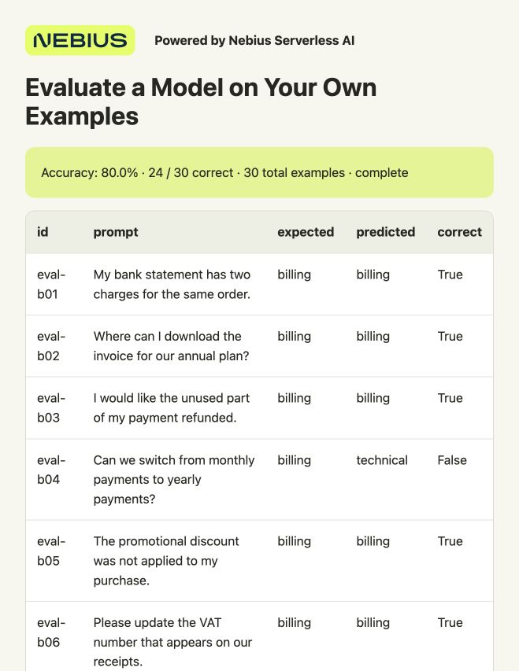

# Evaluate a Model on Your Own Examples

Check how often Qwen assigns a support request to the right category: **billing**, **technical** or **account**. You'll compare its answers with 30 labeled examples and build a browser report showing the score and individual mistakes.

Nebius Serverless AI runs the model on a cloud GPU, so you don't need to configure a GPU server. You'll create an **Endpoint**—a model API you call over HTTPS. Your computer sends the examples, checks the answers and saves the report.

**Preemptible instances give you a way to do more with your GPU budget.** They provide GPU capacity at a changing market price that can be lower than the regular rate. The trade-off is that a run can be interrupted. This cookbook saves each prediction on your computer, so you can resume the evaluation and process only the remaining examples.

For example, during this experiment, this setup was priced at about **$0.80/hour on preemptible compute, compared with $1.60/hour on regular compute**. Prices can change.



**Powered by Nebius Serverless AI**

## What you need

- macOS or Ubuntu, Git and Python **3.10+**. No local GPU or extra Python packages.
- A Nebius account with billing enabled and a project in **eu-north1**. A project holds your cloud resources and their permissions.
- Permission and quota to run **one preemptible L40S GPU**. Quota is your account's resource allowance; check it under **Quotas** in the console if deployment is refused.

## 1. Get the files

```bash
git clone https://github.com/MarouaneKhoukh/nebius-serverless-cookbooks.git
cd nebius-serverless-cookbooks/evaluate-model-spot
python3 --version
```

Run the remaining commands from this directory.

## 2. Sign in to Nebius

The Nebius CLI lets you manage the Endpoint from your terminal. If it isn't installed:

```bash
curl -sSL https://artifacts.nebius.cloud/cli/install.sh | bash
```

Open a new terminal after installation and return to this cookbook's directory. Use CLI **0.12.303 or newer**; run `nebius update` if your version is older.

In the [Nebius console](https://console.nebius.com), select your eu-north1 project and copy its project ID. Replace the **entire** `YOUR_PROJECT_ID` value below:

If you already have a signed-in CLI profile for this project, skip the `profile create` line and replace `cookbook` in `profile activate` with your profile's name.

```bash
nebius version
export NEBIUS_PROJECT_ID="YOUR_PROJECT_ID"
export AI_AGENT="${AI_AGENT:-cookbook}"
nebius profile create cookbook --parent-id "$NEBIUS_PROJECT_ID"
nebius profile activate cookbook
nebius iam whoami
```

Complete the browser sign-in when prompted.

Choose a **subnet**, the network your Endpoint will use. List the project's subnets, then replace `YOUR_SUBNET_ID` with a subnet's `metadata.id`. It must allow outbound internet access to download the model.

```bash
nebius vpc subnet list --parent-id "$NEBIUS_PROJECT_ID" --format json
export NEBIUS_SUBNET_ID="YOUR_SUBNET_ID"
```

<details>
<summary>If your project has no subnet</summary>

Create a network and subnet in the same project:

```bash
export NEBIUS_NETWORK_ID="$(nebius vpc network create --parent-id "$NEBIUS_PROJECT_ID" --name cookbook-network --format jsonpath='{.metadata.id}')"
export NEBIUS_SUBNET_ID="$(nebius vpc subnet create --parent-id "$NEBIUS_PROJECT_ID" --name cookbook-subnet --network-id "$NEBIUS_NETWORK_ID" --format jsonpath='{.metadata.id}')"
```

New networks have a default internet route. If your company manages the network, ask for an approved subnet instead. [Network setup](https://docs.nebius.com/vpc/networking/isolation) · [Default routing](https://docs.nebius.com/vpc/routing/overview)

</details>

## 3. Start the model

The supplied configuration runs **Qwen2.5-0.5B-Instruct** with vLLM on one L40S and a 500 GiB temporary disk. vLLM serves the model's API; you don't need to build a container.

Before launching, check the current rate under **Serverless AI → Endpoints → Create endpoint → Preemptible**. The deployment script uses **Follow Spot price** by default, which accepts the changing price without a maximum. Model loading and idle time are billed too. You'll stop the Endpoint in step 5.

If you ran the [classification cookbook](../batch-inference-spot/README.md), you can use its Endpoint through the reuse option below. Otherwise, create one:

<details>
<summary>Set a maximum GPU price</summary>

A pricing policy sets a maximum **per GPU hour**. A higher maximum can improve allocation priority when demand for the same GPU platform is high. You pay the current market rate while it stays within your limit. Capacity can still be reclaimed. [How allocation works](https://docs.nebius.com/signup-billing/pricing-policy#capacity-allocation)

1. Check the [current price and recent history](https://docs.nebius.com/signup-billing/spot-prices). Choose a maximum within your budget, with room for price increases. A limit below the current rate blocks startup.
2. In **Billing → Pricing → Pricing policy → Create pricing policy**, enter a name using letters/numbers, select your project and **`gpu-l40s-a`**, and enter that maximum. Create the policy and copy its ID.
3. Add `--spot-pricing-policy-id "YOUR_POLICY_ID"` to both `create` commands below, replacing the whole placeholder. The deployment script will use that policy.

Choose the policy before launching. Before changing its maximum, stop the Endpoints using it and wait for any Jobs using it to finish, or cancel them.

A tight limit can cause more interruptions as prices rise. **Follow Spot price** accepts price changes without a cap, including prices above regular rates. A GPU price limit does not cap the total cost of a run or its storage.

[Policy setup](https://docs.nebius.com/signup-billing/manage-pricing-policy) · [Pricing options](https://docs.nebius.com/signup-billing/pricing-policy)

</details>

```bash
python3 scripts/endpoint.py create --project-id "$NEBIUS_PROJECT_ID" --subnet-id "$NEBIUS_SUBNET_ID" --name cookbook-evaluate-spot --dry-run
python3 scripts/endpoint.py create --project-id "$NEBIUS_PROJECT_ID" --subnet-id "$NEBIUS_SUBNET_ID" --name cookbook-evaluate-spot --yes
python3 scripts/endpoint.py wait --timeout 1800
```

The first command previews the deployment; the second creates it. Wait for the model to be ready before continuing. The deployment script passes the API address and authentication token to the client.

<details>
<summary>Reuse the classification cookbook's Endpoint</summary>

Use this option **instead of** the three create/wait commands above. In the classification cookbook's directory, run `python3 scripts/endpoint.py status` and copy the Endpoint ID. Return here, replace the entire `YOUR_ENDPOINT_ID` value and run:

```bash
python3 scripts/endpoint.py attach --project-id "$NEBIUS_PROJECT_ID" --id "YOUR_ENDPOINT_ID"
python3 scripts/endpoint.py start
python3 scripts/endpoint.py wait --timeout 1800
```

The Endpoint must serve `Qwen/Qwen2.5-0.5B-Instruct` with token authentication on preemptible compute. Continue at step 4 and stop it after your final client has finished.

</details>

<details>
<summary>Ask an agent to run it instead</summary>

Install the [Nebius agent skills](https://github.com/nebius/skills#install) for your coding agent, then paste the prompt below. The agent needs terminal access and the CLI sign-in from step 2. Skills are optional for the CLI instructions above.

```text
Run this cookbook in Nebius project <MY_PROJECT_ID> using
nebius-cloud-basics and nebius-serverless-endpoints. Follow README.md and
config/endpoint.json. Reuse the classification cookbook's compatible
Endpoint, or show the current price and confirm a new preemptible deployment.
Wait for the model and evaluate data/evaluation.csv. Inspect all 30
predictions, the accuracy score and the mistakes. Stop this cookbook's
Endpoint and verify STOPPED. Keep authentication tokens private.
```

</details>

## 4. Check the answers

```bash
python3 scripts/endpoint.py run -- python3 src/evaluate.py --input data/evaluation.csv --output-dir results
```

Open `results/report.html` in your browser. It shows the model's score and examples it got wrong. You can also inspect:

- `results/scores.json`: accuracy and correct, incorrect and invalid-answer counts.
- `results/predictions.csv`: every request, expected label and model prediction.
- `results/mistakes.csv`: the incorrect or invalid answers.

**Accuracy is correct answers divided by evaluated examples.** An answer with multiple labels or extra explanation counts as incorrect. Wait for all 30 examples before comparing scores:

```bash
python3 -c 'import json; r=json.load(open("results/scores.json")); print(r); assert r["complete"] and r["evaluated_examples"] == 30'
```

These fictional examples teach the evaluation workflow. For a useful score on your own task, use examples that reflect the requests your model will receive.

## 5. Stop the Endpoint

```bash
python3 scripts/endpoint.py stop
```

Wait for `STOPPED`. This releases the GPU and temporary disk; your local results remain. The Endpoint stays running and billable until you stop it, even after evaluation finishes.

## If the GPU is reclaimed

Your saved answers remain on your computer. When capacity is available, restart the Endpoint and run the same evaluation with the same results directory:

```bash
python3 scripts/endpoint.py start
python3 scripts/endpoint.py wait --timeout 1800
python3 scripts/endpoint.py run -- python3 src/evaluate.py --input data/evaluation.csv --output-dir results
python3 scripts/endpoint.py stop
```

Completed examples are skipped. A request whose answer wasn't saved may run again. The Endpoint needs an explicit restart; it doesn't recover automatically.

<details>
<summary>Use your own examples or try resuming</summary>

Copy `data/evaluation.csv`, keeping the `id,prompt,expected` columns, unique IDs and one expected label per row. For a different classification task, edit `LABELS` and `SYSTEM_PROMPT` together in `src/runner.py`.

Keep evaluation examples separate from training data. To compare a model before and after fine-tuning, use the same test examples and scoring rule. Continue with [Fine-Tune Qwen and Resume Saved Training](../fine-tune-resume-spot/README.md) to try this.

Use a new output directory when changing the input, model or settings. To try client resumption, run the step 4 command with `--output-dir results-resume --limit 5`, then repeat it without `--limit 5`. The second run skips the first five answers.

If you run the client in a temporary notebook or another machine, keep its results directory on storage that survives that session.

</details>

<details>
<summary>Troubleshooting and test results</summary>

- **Sign-in error:** sign in again with your CLI profile. For API 401/403 errors, check the Endpoint's token-authentication setting.
- **Quota exceeded:** request a higher allowance in the console.
- **No capacity:** try again when preemptible GPUs become available.
- **`RUNNING` but the API isn't ready:** use the wait command; check Endpoint logs if it times out.
- **Invalid answers:** inspect their raw text in `predictions.csv`.
- **Input or settings changed:** choose a new output directory.

The recorded run scored 24/30 (80%) and reused saved answers on a second client run. Natural GPU preemption was not observed. [Validation and recorded prices](VALIDATION.md) · [Saved predictions](docs/sample-results/predictions.csv)

Run local checks with `python3 -m unittest discover -s tests -v`.

</details>

[Serverless AI](https://docs.nebius.com/serverless/overview) · [Preemptible instances](https://docs.nebius.com/compute/virtual-machines/preemptible) · [Endpoint stop/start](https://docs.nebius.com/serverless/maintenance/stop-start) · [vLLM template](https://github.com/nebius/serverless-ai-cookbook/tree/main/templates/endpoint-vllm-qwen3-0-6b)

The sample requests are fictional; no customer data is included.
