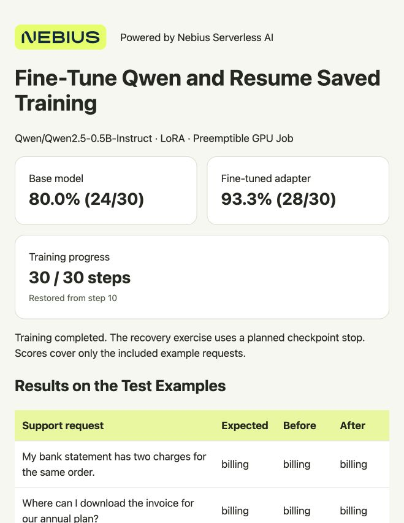

# Fine-Tune Qwen and Resume Saved Training

Teach Qwen to classify support requests as **billing**, **technical** or **account** using 120 included examples. You'll save a LoRA adapter—the model changes learned during training—and compare its answers with the original model on 30 separate test examples.

Nebius Serverless AI runs the training on a cloud GPU using a prepared Axolotl training environment. You don't need to configure a GPU server. You'll launch a **Job**, which runs your code and finishes when the work ends.

**Preemptible instances give you a way to do more with your GPU budget.** They provide GPU capacity at a changing market price that can be lower than the regular rate. The trade-off is that a run can be interrupted. This cookbook saves full training checkpoints in cloud storage, so a new Job can pick up from the last saved step.

For example, during this experiment, this setup was priced at about **$0.84/hour on preemptible compute, compared with $4.55/hour on regular compute**. Prices can change.



**Powered by Nebius Serverless AI**

## What you need

- macOS or Ubuntu, Git and Python **3.10+**. No local GPU or extra Python packages.
- A Nebius account with billing enabled and a project in **eu-north1**. A project holds your cloud resources and their permissions.
- Permission and quota to run **one preemptible H100 GPU**. Quota is your account's resource allowance; check it under **Quotas** in the console if deployment is refused.
- Permission to create Jobs and an Object Storage bucket in the same project.

## 1. Get the files

```bash
git clone https://github.com/MarouaneKhoukh/nebius-serverless-cookbooks.git
cd nebius-serverless-cookbooks/fine-tuning-with-checkpoints
python3 --version
```

Run the remaining commands from this directory.

## 2. Sign in to Nebius

The Nebius CLI lets you manage Jobs from your terminal. If it isn't installed:

```bash
curl -sSL https://artifacts.nebius.cloud/cli/install.sh | bash
```

Open a new terminal after installation and return to this cookbook's directory. Use CLI **0.12.303 or newer**; run `nebius update` if your version is older.

In the [Nebius console](https://console.nebius.com), select your eu-north1 project and copy its project ID. Replace the **entire** `YOUR_PROJECT_ID` value below:

If you already have a signed-in CLI profile for this project, skip the `profile create` line and replace `cookbook` in `profile activate` with your profile's name.

```bash
nebius version
export PROJECT_ID="YOUR_PROJECT_ID"
export AI_AGENT="${AI_AGENT:-cookbook-reader}"
nebius profile create cookbook --parent-id "$PROJECT_ID"
nebius profile activate cookbook
nebius iam whoami --format json
```

Complete the browser sign-in when prompted.

Choose a **subnet**, the network your Jobs will use. List the project's subnets, then replace `YOUR_SUBNET_ID` with a subnet's `metadata.id`. It must allow outbound internet access to download the model.

```bash
nebius vpc subnet list --parent-id "$PROJECT_ID"
export SUBNET_ID="YOUR_SUBNET_ID"
```

<details>
<summary>If your project has no subnet</summary>

Create a network and subnet in the same project:

```bash
export NETWORK_ID="$(nebius vpc network create --parent-id "$PROJECT_ID" --name cookbook-network --format jsonpath='{.metadata.id}')"
export SUBNET_ID="$(nebius vpc subnet create --parent-id "$PROJECT_ID" --name cookbook-subnet --network-id "$NETWORK_ID" --format jsonpath='{.metadata.id}')"
```

New networks have a default internet route. If your company manages the network, ask for an approved subnet instead. [Network setup](https://docs.nebius.com/vpc/networking/isolation) · [Default routing](https://docs.nebius.com/vpc/routing/overview)

</details>

## 3. Create storage for your progress

A **bucket** stores files in the cloud. The training Jobs will save their checkpoints and final results there, so the files survive when a Job's GPU stops.

Choose a unique bucket name and create it in the same project and region as the Jobs:

```bash
python3 scripts/job.py create-bucket \
  --project-id "$PROJECT_ID" --name "YOUR_UNIQUE_BUCKET_NAME" --yes
```

Copy the returned bucket ID into `BUCKET_ID`. `RUN_ID` names this training run's folder in the bucket; keep both values for the second Job.

```bash
export BUCKET_ID="YOUR_BUCKET_ID"
export RUN_ID="support-lora-demo"
```

## 4. Train the first ten steps

The supplied configuration uses **Qwen2.5-0.5B-Instruct**, a prepared Axolotl training image, one H100, a 500 GiB temporary disk and a one-hour limit per Job. The script uploads the included code and examples for you.

Before launching, check the current preemptible H100 rate in the Nebius console. The deployment script uses **Follow Spot price** by default, which accepts the changing price without a maximum. Provisioning and model loading are billed too.

<details>
<summary>Set a maximum GPU price</summary>

A pricing policy sets a maximum **per GPU hour**. A higher maximum can improve allocation priority when demand for the same GPU platform is high. You pay the current market rate while it stays within your limit. Capacity can still be reclaimed. [How allocation works](https://docs.nebius.com/signup-billing/pricing-policy#capacity-allocation)

1. Check the [current price and recent history](https://docs.nebius.com/signup-billing/spot-prices). Choose a maximum within your budget, with room for price increases. A limit below the current rate blocks startup.
2. In **Billing → Pricing → Pricing policy → Create pricing policy**, enter a name using letters/numbers, select your project and **`gpu-h100-sxm`**, and enter that maximum. Create the policy and copy its ID.
3. Add `--spot-pricing-policy-id "YOUR_POLICY_ID"` to both `submit` commands below and the `resume` command in step 5, replacing the whole placeholder. The deployment script will use that policy.

Choose the policy before launching. Before changing its maximum, stop the Endpoints using it and wait for any Jobs using it to finish, or cancel them.

A tight limit can cause more interruptions as prices rise. **Follow Spot price** accepts price changes without a cap, including prices above regular rates. A GPU price limit does not cap the total cost of a run or its storage.

[Policy setup](https://docs.nebius.com/signup-billing/manage-pricing-policy) · [Pricing options](https://docs.nebius.com/signup-billing/pricing-policy)

</details>

```bash
python3 scripts/job.py submit \
  --project-id "$PROJECT_ID" --bucket-id "$BUCKET_ID" --subnet-id "$SUBNET_ID" \
  --run-id "$RUN_ID" --stop-after-step 10 --dry-run

python3 scripts/job.py submit \
  --project-id "$PROJECT_ID" --bucket-id "$BUCKET_ID" --subnet-id "$SUBNET_ID" \
  --run-id "$RUN_ID" --stop-after-step 10 --yes
```

The first command previews the deployment; the second creates it. Keep the returned Job ID and use it below:

```bash
python3 scripts/job.py status --job-id YOUR_FIRST_JOB_ID
python3 scripts/job.py logs --job-id YOUR_FIRST_JOB_ID
```

Wait for `COMPLETED`. In the logs, look for `checkpoint_published` at `global_step: 10` and `recipe_finished` with `completed: false`.

`COMPLETED` means this ten-step Job has finished. Training still has 20 steps left. This planned stop lets you try restoring progress in a separate Job.

<details>
<summary>Ask an agent to run it instead</summary>

Install the [Nebius agent skills](https://github.com/nebius/skills#install) for your coding agent, then paste the prompt below. The agent needs terminal access and the CLI sign-in from step 2. Skills are optional for the CLI instructions above.

```text
Run this cookbook in Nebius project <MY_PROJECT_ID> using
nebius-cloud-basics, nebius-serverless-jobs and
nebius-serverless-data-secrets. Follow README.md and the supplied config.
Show the current price and confirm the deployment before launching a
preemptible H100 Job. Use a bucket in the same project. Train to step 10,
verify the checkpoint, then launch a new Job with the same bucket and run ID.
Verify that it resumes at step 10 and finishes at step 30. Download result.zip
and check it with --require-resume. Compare the before/after scores and
verify that both Jobs have finished. Keep authentication tokens private.
```

</details>

## 5. Resume and finish training

Use the same bucket and run ID. This command launches a new Job that loads the saved checkpoint. `--stop-after-step 0` tells it to finish the original 30-step training schedule.

```bash
python3 scripts/job.py resume \
  --project-id "$PROJECT_ID" --bucket-id "$BUCKET_ID" --subnet-id "$SUBNET_ID" \
  --run-id "$RUN_ID" --stop-after-step 0 --yes
```

Keep the new Job ID. Check the latest Job with:

```bash
python3 scripts/job.py status
python3 scripts/job.py logs
```

Wait for `COMPLETED`. Its logs should show `training_started` at step **10**, then `recipe_finished` with `resumed_from_step: 10`, `global_step: 30` and `completed: true`. The Job saves the final adapter and evaluates it on the 30 test examples.

## 6. Download the results

In the Nebius console, open **Object Storage → your bucket → `support-lora-demo`** (or your chosen `RUN_ID`). Select `result.zip`, then choose **Actions → Download**.

From this cookbook's directory, check and unpack the downloaded file:

```bash
python3 scripts/check_result.py ~/Downloads/result.zip --require-resume
python3 -m zipfile -e ~/Downloads/result.zip results
```

Open `results/report.html` in your browser. Compare the before-and-after accuracy and inspect each prediction. A small training run can improve or reduce accuracy; judge it on examples that matter to your task.

Your trained adapter is in `results/adapter/`. The report and adapter are saved on your computer, so you can inspect them after the Jobs finish.

## 7. Check that compute has stopped

A completed, failed or cancelled Job has no running GPU. Check both Job IDs. If either is still active and you are finished, cancel only that Job:

```bash
python3 scripts/job.py cancel --job-id YOUR_JOB_ID --yes
python3 scripts/job.py status --job-id YOUR_JOB_ID
```

Wait for `CANCELLED` or another terminal state. The bucket still holds your files and incurs storage charges. Keep it for recovery and downloads; when finished, remove this recipe's files and bucket in the console. Leave shared buckets intact.

## If the GPU is reclaimed

Check that the previous Job has stopped. If it saved a complete checkpoint, repeat step 5 using the same bucket and run ID. The new Job repeats only the work since the last checkpoint, which is saved every ten training steps.

If the first Job stops before saving any checkpoint, choose a new `RUN_ID` and repeat step 4. Jobs do not automatically restart after a preemption.

<details>
<summary>Use your own data or inspect the checkpoints</summary>

Replace `data/train.jsonl` with examples for your task and keep a separate test set in `data/test.csv` with `id,prompt,expected` columns. Update the labels and system prompt in `src/evaluate.py` to match. Use a new run ID after changing data, model or settings.

The training configuration is in `config/train.yaml`. It saves every ten steps and trains for 30 steps in total. Keep the total fixed when resuming. A planned stopping point must fall on a save step below the final step.

The bucket contains full checkpoints, including adapter weights, optimizer, scheduler, RNG and trainer state. Only checkpoints with a valid `complete.json` are restored. The first phase also produces `recovery-SESSION.zip`, whose exact filename appears in the logs. The final `result.zip` includes a checkpoint record and run settings, while the full recovery state remains in the bucket.

The adapter alone is for using the trained model. Resuming training requires the full checkpoint; the second Job loads it from the bucket automatically.

</details>

<details>
<summary>Troubleshooting and test results</summary>

- **Quota exceeded:** request a higher allowance in the console.
- **No capacity:** try again when preemptible GPUs become available.
- **Long startup or no output:** check Job logs. Cancel a stuck Job while diagnosing it.
- **Run settings changed:** choose a new run ID; keep the existing checkpoints.
- **No complete checkpoint:** use a new run ID and start again from step 4.
- **Storage error:** check that the bucket is in the Jobs' project and region and is mounted at `/data` with write access.

The recorded run restored step 10 in a fresh Job and finished at step 30. Its test score changed from 24/30 (80.0%) to 28/30 (93.3%). Recovery used a planned stop; natural GPU preemption was not observed. [Validation and recorded prices](VALIDATION.md) · [Saved report](docs/sample-results/report.html)

Run local checks with `python3 -m unittest discover -s tests -v`.

</details>

[Serverless AI](https://docs.nebius.com/serverless/overview) · [Preemptible instances](https://docs.nebius.com/compute/virtual-machines/preemptible) · [Job management](https://docs.nebius.com/serverless/jobs/manage) · [Axolotl Job template](https://github.com/nebius/serverless-ai-cookbook/tree/main/templates/job-axolotl-finetune)

The sample requests are fictional; no customer data is included.
