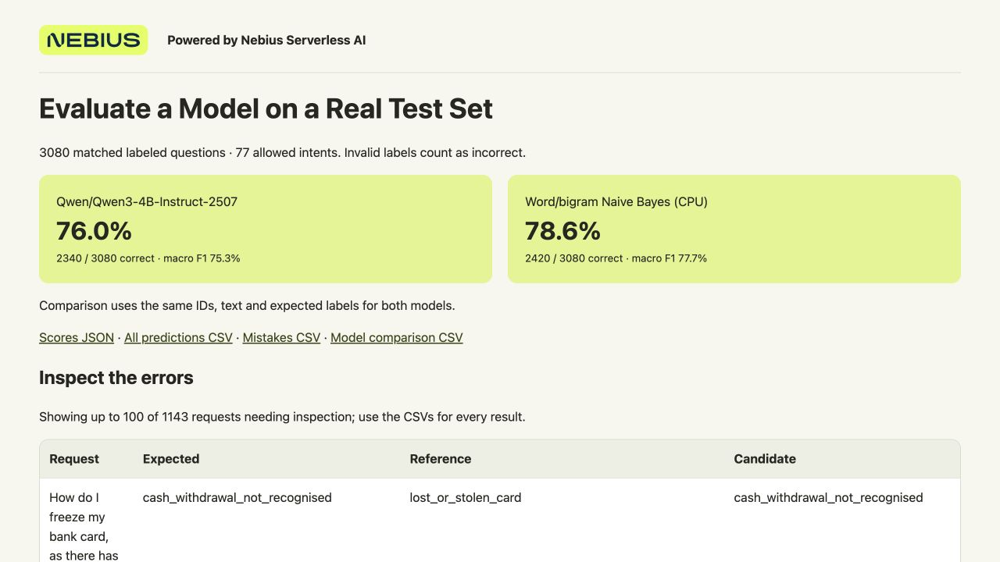

# Evaluate a Model on a Real Test Set

Score **3,080 real BANKING77 questions across 77 intents**, compare Qwen with a trained CPU baseline and inspect where each model fails. You get accuracy, macro F1, per-intent results, confusion counts and CSVs for review.

The included predictions came from **preemptible Nebius Serverless AI Jobs** running Qwen3-4B-Instruct-2507. Evaluation itself runs locally: counting correct labels doesn't need another GPU. Use the complete saved export, supply your own predictions, or generate new predictions with the optional finite Job below.

## What you need

- macOS or Ubuntu, Git and Python **3.10+**. The first path needs no cloud account, GPU or additional Python packages.
- For new GPU predictions: a billing-enabled Nebius project in **eu-north1**, permission to create Jobs and use Object Storage, and quota for one preemptible L40S.

## 1. Get the files

```bash
git clone https://github.com/MarouaneKhoukh/nebius-serverless-cookbooks.git
cd nebius-serverless-cookbooks/model-evaluation
```

Run all commands from this directory. The real question text, expected labels and saved model outputs are bundled in `data/reference-results.zip`. The evaluator verifies its fixed source, checksums, input joins and license before use. These are human-authored benchmark questions, not production bank logs. [Source and license](data/SOURCE.md).

## 2. Score the saved predictions

```bash
python3 src/evaluate.py --output-dir results
```

Open **`results/report.html`**. It should show **3,080 questions**, Qwen at **76.0% accuracy**, and the CPU baseline at **78.6%**.



**Powered by Nebius Serverless AI**

The comparison shows:

- Both correct: **1,937** questions.
- Qwen correct, CPU baseline wrong: **403**.
- CPU baseline correct, Qwen wrong: **483**.
- Both wrong: **257**.

Use `mistakes.csv` and `comparisons.csv` to inspect those questions. `scores.json` contains macro F1, per-intent precision/recall and confusion counts. Invalid labels count as incorrect; they aren't dropped from the denominator.

For this dataset, start with the CPU baseline. Qwen used 77 training examples in its prompt; Naive Bayes fitted all 10,003 source training rows. The comparison uses different supervision budgets, so it isn't an equal-data benchmark. [Validation and limitations](VALIDATION.md).

## 3. Compare your own predictions

A reference CSV needs `id,prompt,expected,predicted`. A candidate needs `id,predicted`; `prediction` is also accepted for the output column. IDs must be unique, and any supplied question text or expected label must match the reference.

```bash
python3 src/evaluate.py \
  --predictions before_predictions.csv --candidate after_predictions.csv \
  --reference-name "Base model" --candidate-name "My adapter" \
  --output-dir results-comparison
```

Use the same test questions, prompt and generation settings to measure a fine-tuning change. The training cookbook exports these two CSVs. A changed prompt or different model is still a comparison, but it doesn't isolate fine-tuning's effect.

If a candidate intentionally covers only a reference subset, add `--allow-subset`. Both models are then scored on those same IDs; the report records how many reference rows were omitted. Otherwise, missing IDs are an error.

The taxonomy defaults to the 77 exact BANKING77 intent names, including original capitalization and punctuation. Supply `--labels path/to/labels.json` for another task. Use a new output directory for each experiment.

To use your own frontend, add **`--no-report`** for raw CSV/JSON only, or replace `templates/report.html` with `--template YOUR_TEMPLATE.html`. The default showcase remains Nebius-branded; model outputs do not depend on its styling.

## 4. Generate fresh predictions on Serverless

Preemptible GPUs offer lower-priced capacity that Nebius can reclaim. The included finite Job saves every completed batch to Object Storage and resumes only missing batches. It loads Qwen, processes the test split and exits; there is no Endpoint to keep running.

<details>
<summary>Complete CLI setup and GPU run</summary>

Install the Nebius CLI if needed:

```bash
curl -sSL https://artifacts.nebius.cloud/cli/install.sh | bash
```

Open a new terminal and return to this directory. Use CLI **0.12.303+**; run `nebius update` if older. Copy your project ID from the [console](https://console.nebius.com), replace the placeholder and complete browser sign-in:

```bash
export AI_AGENT="${AI_AGENT:-cookbook}"
nebius version
export PROJECT_ID="YOUR_PROJECT_ID"
nebius profile create cookbook --parent-id "$PROJECT_ID"
nebius profile activate cookbook
nebius iam whoami
```

Already signed in? Activate that project's profile instead of creating `cookbook`.

Choose a subnet with outbound internet access for model downloads. Copy its `metadata.id`:

```bash
nebius vpc subnet list --parent-id "$PROJECT_ID" --format json
export SUBNET_ID="YOUR_SUBNET_ID"
```

If none exists, create one with the default internet route:

```bash
export NETWORK_ID="$(nebius vpc network create --parent-id "$PROJECT_ID" --name cookbook-network --format jsonpath='{.metadata.id}')"
export SUBNET_ID="$(nebius vpc subnet create --parent-id "$PROJECT_ID" --name cookbook-subnet --network-id "$NETWORK_ID" --format jsonpath='{.metadata.id}')"
```

Create a private bucket with a unique name, or reuse a bucket in this project. Replace the bucket placeholder with its returned ID:

```bash
python3 scripts/job.py create-bucket \
  --project-id "$PROJECT_ID" --name "YOUR_UNIQUE_BUCKET_NAME" --yes
export BUCKET_ID="YOUR_BUCKET_ID"
export RUN_ID="banking77-evaluation"
```

`config/job.json` pins Qwen3-4B-Instruct-2507 and vLLM 0.19.1, one **L40S**, a **100 GiB temporary disk** and a **one-hour timeout per Job**. Check the rate under **Serverless AI → Jobs → Create job → Preemptible**. L40S currently has a [flat preemptible rate](https://nebius.com/prices), although the CLI calls its setting **Follow Spot price**. Image download, model loading and retries can use paid compute time.

```bash
python3 scripts/job.py submit \
  --project-id "$PROJECT_ID" --subnet-id "$SUBNET_ID" \
  --bucket-id "$BUCKET_ID" --run-id "$RUN_ID" --dry-run
python3 scripts/job.py submit \
  --project-id "$PROJECT_ID" --subnet-id "$SUBNET_ID" \
  --bucket-id "$BUCKET_ID" --run-id "$RUN_ID" --yes
python3 scripts/job.py wait --timeout 3600
python3 scripts/job.py logs --tail 30
```

The Job downloads checksum-verified BANKING77 files and saves batches of 64. Find `result_published` in the logs and download that exact `RUN_ID/exports/ATTEMPT_ID/result.zip` path from **Object Storage → your bucket**.

```bash
python3 src/evaluate.py --archive "$HOME/Downloads/result.zip" --output-dir results-fresh
```

If interrupted, validate any export first. A complete verified export needs no new GPU even if the platform reports `FAILED / Preempted`. If work remains, wait for the old Job to be terminal, keep `.state/job.json` and all original files/settings, then resume:

```bash
python3 scripts/job.py resume --dry-run
python3 scripts/job.py resume --yes
python3 scripts/job.py wait --timeout 3600
python3 scripts/job.py logs --tail 30
```

Check that compute has stopped; cancel an active Job if you aren't continuing. A wait timeout alone doesn't stop it:

```bash
python3 scripts/job.py status
python3 scripts/job.py cancel --yes
python3 scripts/job.py status
```

A completed Job releases its GPU and temporary disk. Retained Object Storage remains billed; later remove only this run's objects or its dedicated bucket, preserving shared data.

</details>

## Run with an agent

The local evaluation command needs only Python. For fresh GPU predictions, install the [Nebius skills](https://github.com/nebius/skills#install) for an agent with terminal access and the signed-in CLI, then paste:

```text
Run model-evaluation in MarouaneKhoukh/nebius-serverless-cookbooks.
First evaluate the bundled real BANKING77 prediction archive locally.
For fresh predictions, use nebius-cloud-basics, nebius-serverless-jobs
and nebius-serverless-data-secrets in project <PROJECT_ID>, subnet
<SUBNET_ID>, bucket <BUCKET_ID>. Follow config/job.json, show the price
and confirm before launching unapproved compute. Retrieve the complete
result.zip, evaluate it locally, inspect errors and verify compute has
stopped. Keep credentials private and preserve saved results.
```

Local checks: `python3 -m unittest discover -s tests -v`.
