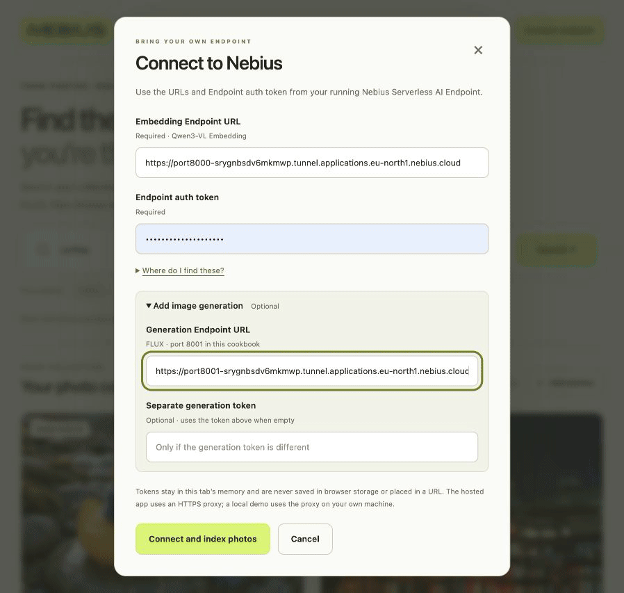

# Search Your Photos and Create New Images

Find photos with **Qwen3-VL**, create missing images with **FLUX 3 Image Klein**, and choose what to keep.

**Powered by Nebius Serverless AI**

[Try the live demo](https://nebius-serverless-search-create.vercel.app) — browse the starter photos, then connect your own Nebius Endpoint to search and create.



[Watch the video](docs/media/byo-endpoint-live.mp4) · [Current interface](docs/media/search-create-core.png)

*Real H200 recording with pauses shortened. The connection screen has since been simplified.*

Both models share one Nebius GPU Endpoint. Use the hosted demo or run the web app locally; saved photos stay in your browser.

## Before you start

- **Computer:** Node.js 22+, Docker Desktop with Buildx, and roughly 100 GB free for the image build (planning estimate). No local GPU needed.
- **Nebius:** a project with billing, `editor` access, a subnet, and quota/capacity for **one H200** with NVIDIA driver **580.65.06+**.
- **Accounts:** GitHub for the container registry and Hugging Face for model access. Review the [FLUX license](https://huggingface.co/black-forest-labs/flux-3-image-klein/blob/main/LICENSE.md).

> The demo and model runtime passed live Regular H200/RTX runs using source injection. The packaged image still needs its own GPU boot test. Spot was preempted twice before readiness. [Validation details](VALIDATION.md).

Already serving both models from this cookbook? Skip to [step 5](#5-search-and-create).

## 1. Get the cookbook

On [the repository](https://github.com/MarouaneKhoukh/nebius-serverless-cookbooks), choose **Code → Download ZIP**, save it in Downloads, then extract it:

```bash
unzip ~/Downloads/nebius-serverless-cookbooks-main.zip -d ~/Downloads
cd ~/Downloads/nebius-serverless-cookbooks-main/photo-video-ai-search
```

The commands below run from this directory. Adjust the path if you saved it elsewhere.

<details>
<summary>Install the tools on macOS</summary>

If Homebrew is missing, install it and follow its printed PATH instructions:

```bash
/bin/bash -c "$(curl -fsSL https://raw.githubusercontent.com/Homebrew/install/HEAD/install.sh)"
```

Then install Node and Docker:

```bash
brew install node
brew install --cask docker-desktop
open -a Docker
```

Finish Docker Desktop setup and wait until it is running. Check `node --version`, `docker info`, and `docker buildx version`. On Linux, use an existing Node 22+ and Docker/Buildx installation.

</details>

## 2. Prepare model access

1. Open [FLUX 3 Image Klein](https://huggingface.co/black-forest-labs/flux-3-image-klein) and [its prompt upsampler](https://huggingface.co/black-forest-labs/flux-3-image-klein-pup). Accept their access conditions yourself and wait for approval.
2. Create a Hugging Face **read token** with access to both repositories in [token settings](https://huggingface.co/settings/tokens).
3. In the Nebius console, select your intended project. Under **SecretStash**, create a secret with a payload entry named **`HF_TOKEN`** containing that token. Save the secret ID. Keep the token out of source code and plain environment variables.
4. Check **IAM**, **Limits → Quotas**, and **Networking → Virtual Networks → Subnets**. Save your project and subnet IDs; confirm the GPU and driver requirements above before paying for a run.

## 3. Build the GPU image

Create a GitHub **classic personal access token** with `write:packages` under **Settings → Developer settings → Personal access tokens**. Replace the usernames below; the image path must use lowercase:

```bash
docker login ghcr.io -u YOUR_GITHUB_USERNAME
export IMAGE=ghcr.io/YOUR_LOWERCASE_USERNAME/photo-video-search-generate:flux3-v1
docker buildx build --platform linux/amd64 \
  -f endpoint/Dockerfile -t "$IMAGE" --push .
```

Paste the GitHub token only at Docker's password prompt. After the push succeeds, open **GitHub profile → Packages → your image → Package settings** and make the package **Public**, so Nebius can pull it. The image contains runtime code; gated weights download later using your secret.

## 4. Create the Endpoint

In your selected Nebius project, open **Serverless AI → Endpoints → Create endpoint → Custom**:

| Setting | Value |
| --- | --- |
| Name | `media-search-generate` |
| Image | The full `$IMAGE` path from step 3 |
| Entrypoint | Leave empty |
| Ports | **8000 / HTTP** and **8001 / HTTP** |
| Authentication | **Token**; save the generated token |
| GPU | **Regular H200**, `1 GPU / 16 vCPUs / 200 GiB` |
| Disk / shared memory | **500 GiB / 16 GiB** |
| Secret environment variable | **`HF_TOKEN`**, referencing the secret from step 2 |
| Network | Your selected project's subnet |

Review the current price, then create **once**. Save the Endpoint ID and both **Overview → Public endpoints** URLs. **Running** can appear before the models finish loading; step 5 checks model readiness.

<details>
<summary>Use Spot instead</summary>

In the same form, choose **Preemptible** and a pricing policy for your project and H200. Create a policy if needed, choosing a maximum **USD price per GPU-hour** after checking the current quote. Use a separate name, such as `media-search-generate-spot`.

Spot can stop during startup or inference, even below your price cap. It does not automatically restart. For **Stopped / Preempted**, review the current price and restart the **same Endpoint**, then wait for the models and reconnect. Do not automatically repeat an interrupted generation.

Our two Spot attempts were preempted before inference; this route is not yet validated for serving. [Recorded results](docs/evidence/spot-endpoint-2026-11-03.json) · [Spot pricing](https://docs.nebius.com/signup-billing/pricing-policy).

</details>

<details>
<summary>Create with the CLI instead</summary>

Install the CLI if needed:

```bash
curl -sSL https://artifacts.nebius.cloud/cli/install.sh | bash
```

Restart Terminal, return to this cookbook directory, then sign in. Use CLI **0.12.299+**; run `nebius update` if older. Reuse an existing suitable profile, or create one for your intended tenant/project:

```bash
export AI_AGENT="${AI_AGENT:-codex}"
nebius version
nebius profile create
```

Set your actual IDs and the image built in step 3. The secret must contain the `HF_TOKEN` payload entry:

```bash
export PROJECT_ID=project-REPLACE_WITH_YOUR_ID
export SUBNET_ID=vpcsubnet-REPLACE_WITH_YOUR_ID
export HF_TOKEN_SECRET=REPLACE_WITH_YOUR_SECRET_ID
export IMAGE=ghcr.io/YOUR_LOWERCASE_USERNAME/photo-video-search-generate:flux3-v1
export ENDPOINT_NAME=media-search-generate
PRICING_ARGS=(--on-demand)
nebius compute platform list --parent-id "$PROJECT_ID" --format json
```

Confirm `gpu-h200-sxm` / `1gpu-16vcpu-200gb` is listed. For Spot it must report `allowed_for_preemptibles: true`.

**For capped Spot**, list and reuse a policy for the same project/platform, or create one once. `2.000` is an example cap; choose your own after checking the current quote:

```bash
nebius billing pricing-policy list --parent-id "$PROJECT_ID" --format json
# Only if no suitable policy exists:
nebius billing pricing-policy create \
  --parent-id "$PROJECT_ID" --name media-search-gpu-cap \
  --compute-instance-spec-v1-platform gpu-h200-sxm \
  --pricing-max-price-v1-max-price 2.000 --format json
```

Copy its `metadata.id`, then select Spot instead of the default Regular mode:

```bash
export ENDPOINT_NAME=media-search-generate-spot
export SPOT_PRICING_POLICY_ID=pricingpolicy-REPLACE_WITH_YOUR_ID
PRICING_ARGS=(--preemptible --spot-pricing-policy-id "$SPOT_PRICING_POLICY_ID")
```

A cap below the current market price blocks startup; disk and tax are separate.

Check whether the chosen Endpoint name already exists. Reuse a compatible one; resolve access errors before creating anything:

```bash
nebius ai endpoint get-by-name --parent-id "$PROJECT_ID" --name "$ENDPOINT_NAME" \
  --format jsonpath='{.metadata.id}{"\n"}{.status.state}{"\n"}{.status.public_endpoints}{"\n"}'
```

If it does not exist, create it once:

```bash
nebius ai endpoint create \
  --parent-id "$PROJECT_ID" --name "$ENDPOINT_NAME" --image "$IMAGE" \
  --platform gpu-h200-sxm --preset 1gpu-16vcpu-200gb \
  --subnet-id "$SUBNET_ID" \
  --container-port 8000/http --container-port 8001/http \
  --disk-size 500Gi --shm-size 16Gi \
  --env-secret "HF_TOKEN=$HF_TOKEN_SECRET" --auth token \
  "${PRICING_ARGS[@]}" --async
```

Creation returns an **operation ID**. Repeat the safe `get-by-name` read above to obtain the actual **Endpoint ID**, state and URLs; do not repeat creation. Get the generated Endpoint token from **Overview → View code**, copying only the value after `--token`.

To restart a stopped recipe Endpoint deliberately:

```bash
nebius ai endpoint start --id aiendpoint-REPLACE_WITH_YOUR_ID --async
```

</details>

<details>
<summary>Deploy with Nebius skills in your agent</summary>

Complete model access and image publication above. Install/sign in to the CLI using the preceding option, then install the [Nebius skills](https://github.com/nebius/skills):

```bash
npx skills add nebius/skills
```

Select `nebius-cloud-basics`, `nebius-serverless-endpoints`, and `nebius-serverless-data-secrets` for your agent. Open this cookbook directory and use:

```text
Run this cookbook using the installed Nebius skills and README.md.
Use my selected existing project, built image and HF_TOKEN secret.
Confirm their IDs, GPU/driver compatibility, current cost and stop deadline.
Deploy one H200 with ports 8000/http and 8001/http, token auth,
500 GiB disk and 16 GiB shared memory. Use the image's default entrypoint.
Use Regular unless I choose capped Spot; never change projects or replace
an existing working Endpoint to try Spot. Keep credentials out of chat.
Wait for both models. Launch the demo, verify coffee matches and football
shows no match. Show the prompt before generating; let me approve it and
choose Add or Discard. Report what actually worked and stop only this
recipe's Endpoint at the agreed deadline.
```

</details>

## 5. Search and create

Start the web app:

```bash
cd hosted-demo
node server.mjs
```

Open **[http://127.0.0.1:8085](http://127.0.0.1:8085/)** on this computer. Keep the terminal running.

1. Search **coffee**. Connect with your **port-8000 public HTTPS URL** and **Endpoint token**; choose **Connect and index photos**. Wait for the three starter photos to be indexed.
2. Confirm **Coffee beans** appears. Try **espresso**, then **football**: the starter collection should show **No matching photos** for football.
3. Choose **Yes, create an image**, or enter a description and choose **Create an image**. Connect the **port-8001 URL** when asked; the same Endpoint token is reused.
4. Review/edit the prompt → **Approve and generate** → inspect the unsaved preview.
5. Choose **Add to collection** to make it searchable, or **Discard** to leave the collection unchanged. Search for an image you saved.

Use base URLs **without `/v1`**. The Endpoint token is different from your Nebius account or Hugging Face token. If you lost it, open **Endpoint Overview → View code** and copy only its `--token` value; do not run that example's create command.

Photos stay in this browser, with a **20-image limit**. Tokens and vectors stay in page memory, so reconnect after reloading. Collections do not sync across devices.

## 6. Stop the GPU

In **Serverless AI → Endpoints**, stop this recipe's Endpoint and wait for **Stopped**. Or, using its saved resource ID:

```bash
export AI_AGENT="${AI_AGENT:-codex}"
nebius ai endpoint stop --id aiendpoint-REPLACE_WITH_YOUR_ID
nebius ai endpoint get --id aiendpoint-REPLACE_WITH_YOUR_ID \
  --format jsonpath='{.status.state}'
```

Closing the app or disconnecting does **not** stop GPU billing. Stop the local web server with **Ctrl+C**; your saved browser photos remain.

<details>
<summary>Troubleshooting</summary>

| Problem | Fix |
| --- | --- |
| Local page cannot be reached | Run `node server.mjs` from `hosted-demo/` and keep its terminal open. |
| Models not ready / 503 | Wait for startup to finish and retry the connection, not Endpoint creation. |
| Token rejected / 401 | Copy the selected Endpoint's token; account and Hugging Face tokens do not work here. |
| Spot was preempted | Review the price, restart the same Endpoint once, wait and reconnect. Avoid repeated restart loops. |
| Generated image missing from search | Choose **Add to collection**; an unsaved or discarded preview is not indexed. |

</details>

## More options

[Persistent Python + Qdrant gallery](docs/QDRANT.md) · [Host the web app](docs/PUBLIC-HOSTING.md) · [Endpoint reference](docs/ENDPOINT.md) · [Validation](VALIDATION.md) · [Photo sources](examples/SOURCES.md)
