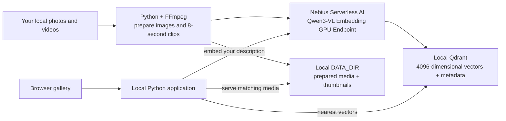

# Build AI Search for Your Photos and Videos

Type a description, find a photo or video clip, and play the result in a gallery. This recipe sends the actual visual media to **Qwen3-VL Embedding 8B on Nebius Serverless AI**, keeps its vectors in **Qdrant**, and runs the gallery on your computer.

The first run creates three synthetic images and a short video, indexes five searchable items, and opens a working gallery. Then point the same ingestion command at your own folder. The intended reader is an AI application developer comfortable running a Python application and a local Docker service.

## See it before you build


[Watch or download the 12-second video](docs/media/gallery-tour.mp4) · [View the screenshot](preview.png)

Watch the recording or browse the animated preview here in the GitHub cookbook before setup. No credentials or running GPU endpoint are needed to view these files. The gallery itself remains the search application at `http://127.0.0.1:8080/` when you run it locally.

*Recorded on 29 October 2026 from the actual interface. Shows browsing and video playback of synthetic media previously indexed with real Qwen3-VL inference on Nebius Serverless AI. No fresh search inference is shown. See [LIVE-TEST.md](LIVE-TEST.md) for separately observed search results; this sample is a pipeline check, not a quality benchmark.*

Every demo displays the [official Nebius logo](https://nebius.com/logo.svg) and **Powered by Nebius Serverless AI**. Logo provenance is in [SOURCE.md](media_search/static/brand/SOURCE.md).

This extends Nebius's [Qwen3-VL Embedding template](https://github.com/nebius/serverless-ai-cookbook/tree/main/templates/endpoint-qwen3-vl-embedding) with persistent storage, bounded video segmentation, repeatable ingestion, and a search interface. The source is included alongside this README; there is no separate hosted application to sign up for.

## Build it with an agent

Paste this prompt into an agent with access to this recipe directory:

```text
Use the files beside this README to run “Build AI Search for Your Photos and Videos.”
Read README.md and VALIDATION.md first. Preserve the Python application, Qdrant
collection contract, and Qwen3-VL chat request format already implemented.

Use Python 3.12+, requirements.txt, Docker Compose, and FFmpeg with ffprobe.
Create a project virtual environment and use .env.example for local settings.
Never print or commit .env, Endpoint tokens, or API keys. Ask me to supply missing
EMBEDDING_BASE_URL and EMBEDDING_API_KEY through local configuration.

You may perform local setup, generate synthetic media, run offline tests, and
start this recipe's local Qdrant/gallery. Do not inspect my cloud account,
provision resources, issue credentials, publish anything, or call the GPU
Endpoint without my authorization for a bounded live test.

With authorization for the live test: check readiness with
python3 -m media_search check-endpoint --timeout 900; generate sample_media with
python3 scripts/make_sample_media.py --output sample_media; ingest it with
python3 -m media_search ingest sample_media; and start python3 -m media_search serve.
On an empty collection, verify 3 images + 2 video clips = 5 points, inspect
the gallery at http://127.0.0.1:8080, and try “red circle” and a video-only query.
Repeat ingestion to verify the same 5 items are skipped without re-embedding.

Report exact checks performed, counts, any failures, and whether real image,
video and text inference and semantic retrieval worked. Distinguish offline
tests from Nebius execution. Do not invent ranks, scores, timing, or costs.
Tell me whether my GPU Endpoint remains running and show its scoped stop command.
```

## What runs where



The GPU Endpoint hosts the model used during ingestion and each text search. It provides a shared inference service without placing the GPU runtime on the gallery machine. Qdrant and prepared media outlive that compute. Browsing already indexed media uses local storage; new semantic searches still need the Endpoint running. This is a managed, continuously running GPU service until you stop it, with no automatic idle scale-to-zero promise.

## Prerequisites

- Python **3.12 or newer** and Docker with **Docker Compose**.
- **FFmpeg and ffprobe** on your command path. The sample generator needs FFmpeg with the `libx264` encoder. Check your installation with `ffmpeg -version` and `ffprobe -version`.
- A token-authenticated Nebius Serverless AI Endpoint serving `Qwen/Qwen3-VL-Embedding-8B`, or a Nebius project with access and quota to create one. The reference configuration uses one H100; capacity and project permissions must be checked in your account.
- Your Endpoint's managed **HTTPS base URL** and saved bearer token. The token belongs in your local `.env`; the browser never receives it.
- Permission to process the media you choose. Prepared image/video bytes are sent to your GPU Endpoint during ingestion, and text descriptions are sent during searches.

Use the [Nebius CLI setup guide](https://docs.nebius.com/cli/install) if you choose the CLI deployment route. Account setup and GPU deployment are separate from installing this local application.

## Get a useful first result

Run the following commands from this directory, `photo-video-ai-search`.

### 1. Install the application and configure the Endpoint

```bash
python3 -m venv .venv
source .venv/bin/activate
python3 -m pip install -r requirements.txt
cp .env.example .env
```

Edit `.env` with your managed Endpoint URL and token:

```dotenv
EMBEDDING_BASE_URL=https://your-managed-endpoint-host
EMBEDDING_API_KEY=your-saved-endpoint-token
```

Use the host URL exactly as shown in **Public endpoints**, with **no `/v1` suffix**. Leave the default model, dimensions, collection, and local Qdrant URL unchanged for this first run. `.env` is read directly by the application; you do not need to source it in your shell.

If you need an Endpoint, follow [Deploy the embedding model](#deploy-the-embedding-model) below, then return here. These steps use the Endpoint and incur the running resource's normal charges.

### 2. Start persistent Qdrant

```bash
docker compose up -d qdrant
```

Wait for the local service with a bounded readiness check:

```bash
python3 - <<'PY'
import time
import urllib.error
import urllib.request

for attempt in range(30):
    try:
        with urllib.request.urlopen("http://127.0.0.1:6333/collections", timeout=2) as response:
            if response.status == 200:
                print("Qdrant is ready")
                break
    except (urllib.error.URLError, TimeoutError):
        pass
    if attempt == 29:
        raise SystemExit("Qdrant was not ready; inspect docker compose logs qdrant")
    time.sleep(2)
PY
```

The Compose service uses `qdrant/qdrant:v1.20.0`, binds only to `127.0.0.1:6333`, and persists its database in the `qdrant_data` named volume. Keep this local development database private.

### 3. Check model readiness and create sample media

```bash
python3 -m media_search check-endpoint --timeout 900
python3 scripts/make_sample_media.py --output sample_media
```

The readiness check polls `/v1/models` and then requests **one text embedding**. A successful check reports `ready: true`, the Qwen model ID, and `dimensions: 4096`. Nebius reporting `RUNNING` alone does not establish that weights have loaded or that inference works.

The sample generator makes three clearly synthetic images—a red circle, blue square, and green triangle—and a 12-second animation. It downloads nothing and makes no model calls. It refuses to overwrite an existing output directory; choose another `--output` if you generated the sample before.

### 4. Index and search

```bash
python3 -m media_search ingest sample_media
python3 -m media_search search "red circle"
python3 -m media_search search "a moving red circle" --kind video
python3 -m media_search serve
```

Open [the gallery](http://127.0.0.1:8080). Search for a description, switch between photos and video clips, and play a returned clip. The backend sends the description to the model and queries Qdrant with its vector. It does not search file names.

On a **new, empty collection**, the expected ingestion summary is:

```json
{"indexed": 5, "skipped": 0, "failed_sources": 0, "collection_points": 5}
```

There are five vectors because each image contributes one and the animation becomes two clips: **0–8 seconds** and **8–12 seconds**. These counts were also observed in the bounded live Nebius run on 29 October 2026; see [the recorded results](LIVE-TEST.md). The synthetic samples exercise the pipeline and do not establish realistic photo/video retrieval quality. Inspect actual returned results rather than expecting a guaranteed score or rank.

Re-running ingestion should report five skipped items and zero new embeddings:

```bash
python3 -m media_search ingest sample_media
```

## Search your own photos and videos

Put a small collection in a folder separate from `DATA_DIR`, then run:

```bash
python3 -m media_search ingest /absolute/path/to/my-media
```

Supported image extensions are `.jpg`, `.jpeg`, `.png`, and `.webp`; video extensions are `.mp4`, `.mov`, `.mkv`, and `.webm`. The command walks subdirectories and ignores symbolic links. Refresh the gallery after ingestion.

The first path is deliberately bounded:

| Input or derivative | Default behavior |
| --- | --- |
| Files per ingestion | At most 20 supported source files; explicitly raise `--max-files` for a larger batch |
| Source images | At most 64 MiB and 40 megapixels; animation unsupported |
| Source videos | At most 512 MiB and 120 seconds; trim longer videos before ingesting |
| Prepared image | Orientation applied, RGB JPEG, longest edge at most 1024 pixels; source metadata omitted |
| Prepared video | Silent H.264 MP4, longest edge at most 448 pixels, 2 frames per second, segments up to 8 seconds |
| Embedding request | Actual JPEG/MP4 encoded as a data URL; each prepared item at most 8 MiB |
| Video embedding | vLLM samples 8 frames from each prepared clip |

Clips contain visual information only. The recipe removes audio and does not transcribe speech. Segment labels preserve the source interval so you can identify the matching part of a video; they are not model-generated moment annotations. Short actions between sampled frames may be missed.

The 8 MiB cap is an application limit. Base64 increases request size, and the exact accepted payload size through a live Nebius gateway still needs validation. For larger libraries, use a controlled ingestion queue and measure workload behavior before increasing limits.

## How the implementation works

The [model card](https://huggingface.co/Qwen/Qwen3-VL-Embedding-8B) describes a shared embedding space for text, images, and videos. This lets a text description find visual content without generating captions first. The recipe uses the full **4096-dimensional** 8B model output.

[`media_search/embedding.py`](media_search/embedding.py) sends all three modalities to `POST /v1/embeddings` using the same model-specific chat format: the instruction `Represent the user's input.`, user content, an empty assistant message, `continue_final_message: true`, and `add_special_tokens: true`. This follows the [pinned vLLM Qwen3-VL example](https://github.com/vllm-project/vllm/blob/v0.19.1/examples/pooling/embed/vision_embedding_online.py). Video requests additionally set `media_io_kwargs.video.num_frames` to 8, supported by the [pinned request schema](https://github.com/vllm-project/vllm/blob/v0.19.1/vllm/entrypoints/pooling/base/protocol.py).

One media request creates one vector. A clip is embedded as native video; its thumbnail and file name are presentation metadata. Returned vectors are checked for dimension, finite values and nonzero norm, then normalized before storage or search. Qdrant ranks the collection by **cosine similarity**, which is a relative ranking score, not a confidence percentage.

[`media_search/media.py`](media_search/media.py) hashes source bytes and preprocessing settings to produce stable asset identities. [`media_search/store.py`](media_search/store.py) uses deterministic point IDs, so identical content can be skipped on later ingestion. `--force` requests re-embedding and overwrites those same points; it does not clear the collection or remove records for deleted source files.

The named vector in Qdrant contains a hash of the model, dimension, instruction, request format, video sampling and media contract. [`media_search/config.py`](media_search/config.py) and `Store.ensure()` reject an incompatible collection even if a different model returns the same vector length. If you change the model, instruction, dimensions or preprocessing contract, use a **new `QDRANT_COLLECTION` and re-ingest everything**. Do not mix old and new embeddings.

### Files worth opening

| File | Purpose |
| --- | --- |
| [`media_search/__main__.py`](media_search/__main__.py) | Ingest, search, readiness and gallery commands |
| [`media_search/media.py`](media_search/media.py) | Image normalization, clip segmentation, thumbnails and content hashes |
| [`media_search/embedding.py`](media_search/embedding.py) | Token-authenticated multimodal model requests and response validation |
| [`media_search/store.py`](media_search/store.py) | Persistent collection, contract checks, upserts and retrieval |
| [`media_search/app.py`](media_search/app.py) | Local API and gallery serving |
| [`compose.yaml`](compose.yaml) | Local Qdrant with durable volume |
| [`scripts/make_sample_media.py`](scripts/make_sample_media.py) | Reproducible synthetic inputs |
| [`VALIDATION.md`](VALIDATION.md) | Executed checks and remaining live validation |

## Deploy the embedding model

An existing compatible, token-authenticated Endpoint is sufficient. Otherwise create a **custom Endpoint** in the [Nebius console](https://console.nebius.com), reviewing this configuration first:

| Setting | Value |
| --- | --- |
| Image | `vllm/vllm-openai:v0.19.1` |
| Entrypoint command | `python3 -m vllm.entrypoints.openai.api_server --model Qwen/Qwen3-VL-Embedding-8B --runner pooling --trust-remote-code --max-model-len 8192 --host 0.0.0.0 --port 8000` |
| Container port | `8000`, HTTP |
| Platform / preset | `gpu-h100-sxm` / `1gpu-16vcpu-200gb` |
| VM type | Regular |
| Disk / shared memory | 500 GiB / 16 GiB |
| Authentication | Token; save the generated token securely |

The pinned image and H100 configuration follow the existing [Nebius template](https://github.com/nebius/serverless-ai-cookbook/tree/main/templates/endpoint-qwen3-vl-embedding). The explicit 8192-token runtime context follows upstream's Qwen3-VL serving example and bounds this small recipe; it is not a statement of the model's maximum context. `--trust-remote-code` is retained from the template. Review the model and its Apache-2.0 license before deploying.

For a CLI route, the helper **prints** the complete, shell-quoted command and never provisions an Endpoint:

```bash
export PROJECT_ID=project-REPLACE_WITH_YOUR_REAL_ID
bash scripts/endpoint-command.sh
```

Replace the placeholder first; the helper rejects it. If your project has multiple subnets, set `SUBNET_ID` to the subnet you selected. The command includes `--parent-id`, token authentication, and agent identification, preserving a nonempty `AI_AGENT` value or using `codex`. It deliberately omits raw-public-IP and preemptible options.

After reviewing the command, you can request a **CLI dry run**:

```bash
bash scripts/endpoint-command.sh --dry-run
```

This invokes `nebius ai endpoint create ... --dry-run`; it does not create the Endpoint. Confirm the flags against your installed CLI and the [current Endpoint documentation](https://docs.nebius.com/serverless/endpoints/manage#how-to-create-an-endpoint). A real create is a separate action: review current pricing and quota, then deliberately run the printed command yourself or use the console. If sharing an agent transcript, keep the resulting token out of it.

Use the managed **HTTPS** URL from **Public endpoints**; a raw public IP is not required for this route. Model download/loading can take additional time after provisioning. The readiness check above establishes a working text request; the subsequent ingestion must establish real image and video inference too.

## Persistence, cost and cleanup

Two local stores must stay together:

- Qdrant's Compose named volume holds vectors and payloads.
- `DATA_DIR` (default `./data`) holds prepared media and thumbnails served by the gallery. Originals remain in your input folder. Keep `DATA_DIR` outside that folder and back it up alongside the Qdrant data.

Neither store lives on the GPU Endpoint. [Stopping an Endpoint](https://docs.nebius.com/serverless/maintenance/stop-start) releases its VM and boot disk, while preserving configuration and its managed URL. Restarting downloads the runtime/model again unless you add a separate cache design. According to [current Serverless pricing](https://docs.nebius.com/serverless/pricing-quotas), a stopped Endpoint incurs no endpoint compute or storage charges; separately mounted storage retains its own billing. Running compute and disk use normal Compute pricing. The bounded live test's lifecycle timestamps are recorded in [the results](LIVE-TEST.md); they are not a startup benchmark or an invoice.

To stop the gallery, press **Ctrl+C** in its terminal. To stop local Qdrant while retaining its database:

```bash
docker compose down
```

Stop your recipe's GPU Endpoint when you no longer need embedding or semantic searches, using its actual ID:

```bash
export AI_AGENT="${AI_AGENT:-codex}"
export ENDPOINT_ID=aiendpoint-REPLACE_WITH_YOUR_ID
nebius ai endpoint stop --id "$ENDPOINT_ID"
```

To use it again, start it and repeat the readiness check:

```bash
nebius ai endpoint start --id "$ENDPOINT_ID"
python3 -m media_search check-endpoint --timeout 900
```

For final removal, [delete only the Endpoint you created for this recipe](https://docs.nebius.com/serverless/endpoints/manage#how-to-delete-an-endpoint):

```bash
nebius ai endpoint delete --id "$ENDPOINT_ID"
```

Deletion invalidates that Endpoint's URL. It does not delete your local collection or media. If you also want to discard this recipe's local Qdrant database, `docker compose down --volumes` is destructive: run it only from this recipe directory after deciding that the indexed data can be removed. Remove the local `data` and `sample_media` directories separately only when you no longer need their contents.

## Troubleshooting and useful next steps

| Symptom | What to check |
| --- | --- |
| Qdrant does not become ready | Docker is running, port 6333 is available, and `docker compose logs qdrant` shows a healthy startup |
| Endpoint returns 401 or 403 | `.env` contains the saved token for this Endpoint; do not paste it into logs |
| Endpoint is running but readiness times out | Check model startup logs, image/model compatibility, quota/capacity and the managed URL; do not redeploy repeatedly |
| Text works but image/video fails | Check real multimodal support, decoding and gateway payload limits; reduce the input before retrying |
| Collection embedding contract differs | Select a new `QDRANT_COLLECTION` and ingest it with a consistent model/prompt/preprocessing configuration |
| Points exist but previews are missing | Restore the matching `DATA_DIR`; the vector database does not contain image or video bytes |
| A source fails ingestion | Read the reported error; invalid files are skipped, while an embedding failure stops the batch. Accepted items remain indexed and are skipped on retry |
| Results seem unrelated | Inspect actual media, use a more concrete description, and evaluate with your own representative queries; scores are not confidence levels |

The automated checks are documented in [`VALIDATION.md`](VALIDATION.md), and the later **successful bounded Nebius run** is recorded in [`LIVE-TEST.md`](LIVE-TEST.md). A real H100 served text, image and native-video embeddings; five items were indexed; all three image queries and the video query ranked their expected sample first within their media-type filters. The GPU Endpoint was stopped after testing. Representative photo/video quality, maximum payload size and large-library behavior remain unmeasured.

To run the offline checks yourself, install the test dependencies and run:

```bash
python3 -m pip install -r requirements-dev.txt
python3 -m pytest -q
```

The optional real local Qdrant test is skipped unless you explicitly select your local service with `QDRANT_TEST_URL=http://127.0.0.1:6333 python3 -m pytest -q`. It creates and removes a uniquely named temporary test collection; it never calls an embedding Endpoint.

After the first real collection works, useful extensions are user-controlled deletion and reconciliation, evaluation with labeled queries, asynchronous ingestion, and deployment of the gallery/Qdrant behind authentication. The current gallery binds only to `127.0.0.1`, has no user accounts or upload UI, and is intended for local use.
