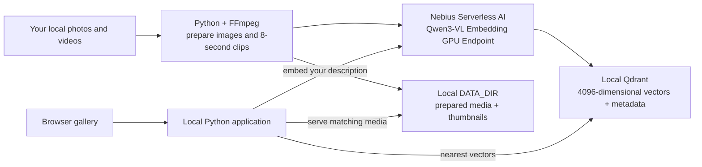

[← Back to the cookbook](../README.md)

# Media search reference

## What runs where



The GPU Endpoint hosts the model used during ingestion and each text search. It provides a shared inference service without placing the GPU runtime on the gallery machine. Qdrant and prepared media outlive that compute. Browsing already indexed media uses local storage; new semantic searches still need the Endpoint running. This is a managed, continuously running GPU service until you stop it, with no automatic idle scale-to-zero promise.

## Media limits

The first path is deliberately bounded:

| Input or derivative | Default behavior |
| --- | --- |
| Files per ingestion | At most 20 supported source files; explicitly raise `--max-files` for a larger batch |
| Source images | At most 64 MiB and 40 megapixels; animation unsupported |
| Source videos | At most 512 MiB and 120 seconds; trim longer videos before ingesting |
| Prepared image | Orientation applied, RGB JPEG, longest edge at most 1024 pixels; source metadata omitted |
| Prepared video | Silent H.264 MP4, longest edge at most 448 pixels, 2 frames per second, segments up to 8 seconds |
| Embedding request | Actual JPEG/MP4 encoded as a data URL; each prepared item at most 8 MiB |
| Video embedding | vLLM samples 8 frames from each prepared clip |

Clips contain visual information only. The recipe removes audio and does not transcribe speech. Segment labels preserve the source interval so you can identify the matching part of a video; they are not model-generated moment annotations. Short actions between sampled frames may be missed.

The 8 MiB cap is an application limit. Base64 increases request size, and the exact accepted payload size through a live Nebius gateway still needs validation. For larger libraries, use a controlled ingestion queue and measure workload behavior before increasing limits.

## How the implementation works

The [model card](https://huggingface.co/Qwen/Qwen3-VL-Embedding-8B) describes a shared embedding space for text, images, and videos. This lets a text description find visual content without generating captions first. The recipe uses the full **4096-dimensional** 8B model output.

[`media_search/embedding.py`](../media_search/embedding.py) sends all three modalities to `POST /v1/embeddings` using the same model-specific chat format: the instruction `Represent the user's input.`, user content, an empty assistant message, `continue_final_message: true`, and `add_special_tokens: true`. This follows the [pinned vLLM Qwen3-VL example](https://github.com/vllm-project/vllm/blob/v0.19.1/examples/pooling/embed/vision_embedding_online.py). Video requests additionally set `media_io_kwargs.video.num_frames` to 8, supported by the [pinned request schema](https://github.com/vllm-project/vllm/blob/v0.19.1/vllm/entrypoints/pooling/base/protocol.py).

One media request creates one vector. A clip is embedded as native video; its thumbnail and file name are presentation metadata. Returned vectors are checked for dimension, finite values and nonzero norm, then normalized before storage or search. Qdrant ranks the collection by **cosine similarity**, which is a relative ranking score, not a confidence percentage.

[`media_search/media.py`](../media_search/media.py) hashes source bytes and preprocessing settings to produce stable asset identities. [`media_search/store.py`](../media_search/store.py) uses deterministic point IDs, so identical content can be skipped on later ingestion. `--force` requests re-embedding and overwrites those same points; it does not clear the collection or remove records for deleted source files.

The named vector in Qdrant contains a hash of the model, dimension, instruction, request format, video sampling and media contract. [`media_search/config.py`](../media_search/config.py) and `Store.ensure()` reject an incompatible collection even if a different model returns the same vector length. If you change the model, instruction, dimensions or preprocessing contract, use a **new `QDRANT_COLLECTION` and re-ingest everything**. Do not mix old and new embeddings.

### Files worth opening

| File | Purpose |
| --- | --- |
| [`media_search/__main__.py`](../media_search/__main__.py) | Ingest, search, readiness and gallery commands |
| [`media_search/media.py`](../media_search/media.py) | Image normalization, clip segmentation, thumbnails and content hashes |
| [`media_search/embedding.py`](../media_search/embedding.py) | Token-authenticated multimodal model requests and response validation |
| [`media_search/store.py`](../media_search/store.py) | Persistent collection, contract checks, upserts and retrieval |
| [`media_search/app.py`](../media_search/app.py) | Local API and gallery serving |
| [`compose.yaml`](../compose.yaml) | Local Qdrant with durable volume |
| [`scripts/make_sample_media.py`](../scripts/make_sample_media.py) | Reproducible synthetic inputs |
| [`VALIDATION.md`](../VALIDATION.md) | Executed checks and remaining live validation |

## Troubleshooting and useful next steps

| Symptom | What to check |
| --- | --- |
| Qdrant does not become ready | Docker is running, port 6333 is available, and `docker compose logs qdrant` shows a healthy startup |
| Endpoint returns 401 or 403 | `.env` contains the saved token for this Endpoint; do not paste it into logs |
| Endpoint is running but readiness times out | Check model startup logs, image/model compatibility, quota/capacity and the managed URL; do not redeploy repeatedly |
| Text works but image/video fails | Check real multimodal support, decoding and gateway payload limits; reduce the input before retrying |
| Collection embedding contract differs | Select a new `QDRANT_COLLECTION` and ingest it with a consistent model/prompt/preprocessing configuration |
| Points exist but previews are missing | Restore the matching `DATA_DIR`; the vector database does not contain image or video bytes |
| A source fails ingestion | Read the reported error; invalid files are skipped, while an embedding failure stops the batch. Accepted items remain indexed and are skipped on retry |
| Results seem unrelated | Inspect actual media, use a more concrete description, and evaluate with your own representative queries; scores are not confidence levels |

The automated checks are documented in [`VALIDATION.md`](../VALIDATION.md), and the later **successful bounded Nebius run** is recorded in [`LIVE-TEST.md`](../LIVE-TEST.md). A real H100 served text, image and native-video embeddings; five items were indexed; all three image queries and the video query ranked their expected sample first within their media-type filters. The GPU Endpoint was stopped after testing. Representative photo/video quality, maximum payload size and large-library behavior remain unmeasured.

To run the offline checks yourself, install the test dependencies and run:

```bash
python3 -m pip install -r requirements-dev.txt
python3 -m pytest -q
```

The optional real local Qdrant test is skipped unless you explicitly select your local service with `QDRANT_TEST_URL=http://127.0.0.1:6333 python3 -m pytest -q`. It creates and removes a uniquely named temporary test collection; it never calls an embedding Endpoint.

After the first real collection works, useful extensions are user-controlled deletion and reconciliation, evaluation with labeled queries, asynchronous ingestion, and deployment of the gallery/Qdrant behind authentication. The current gallery binds only to `127.0.0.1`, has no user accounts or upload UI, and is intended for local use.

## Build it with an agent

Give an agent access to this recipe directory, then use:

```text
Run the existing photo and video search cookbook. Read README.md and follow
its setup steps. Use Python 3.12+, Docker Compose and FFmpeg. Keep Endpoint
tokens in local .env configuration and never print or commit them.

You may install local dependencies and start the local gallery and Qdrant.
Ask before creating paid resources or calling an Endpoint. With authorization,
check model readiness, generate the sample, ingest it and open the gallery.
Expect five items on a fresh collection and verify photo and video searches.
Report what actually worked, any failures, and the final Endpoint state.
```
