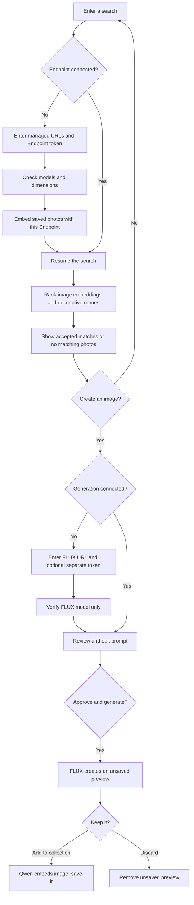

[← Back to the cookbook](../README.md)

# How the connected demo works

The [README](../README.md) contains the complete setup, Endpoint creation, connection, run and shutdown steps. This page explains the two application implementations supplied with the recipe.

| | Connected demo: `hosted-demo/` | Persistent builder: `media_search/` |
| --- | --- | --- |
| Endpoint connection | Each visitor enters their own managed URLs and token | Operator configures URLs/tokens in private `.env` |
| Web runtime | Node.js locally; JavaScript Worker when hosted through Sites | Python/FastAPI on a local or Linux CPU host |
| Saved images and metadata | IndexedDB in the visitor's browser | Host's `DATA_DIR` |
| Vectors | Page memory; re-embedded on each connection | Qdrant collection on the host/private network |
| Who sees saved images | This browser profile on this origin | All visitors to that configured gallery |
| Collection limit | 20 images | Ingestion defaults to 20 sources per batch; storage is not capped at 20 |

Both versions use **Qwen3-VL-Embedding-8B** for image/text embeddings and **FLUX 3 Image Klein** for generation. Both are required to complete this cookbook. Models run on the Nebius GPU Endpoint, not in the browser or CPU web host. The Endpoint does not contain the durable gallery.



## Connecting an Endpoint

The complete demo requires the managed **port-8000 public HTTPS base URL**, the **port-8001 public HTTPS base URL**, and their **Endpoint authentication token**. Search connects first; creation connects when the visitor first chooses to create. The status distinguishes a working search connection from both features being connected. The form uses the embedding token for both unless a different generation token is supplied. Copy both URLs explicitly: do not derive one public hostname from the other.

The token protects the inference Endpoint. A Nebius account API key, project ID, console URL, login token or Hugging Face token is not a substitute. `HF_TOKEN` stays in the GPU runtime's secret environment; the demo does not need it.

In the Nebius console, open **Serverless AI → Endpoints → your Endpoint → Overview**. Copy both port 8000 and port 8001 URLs from **Public endpoints**. Use the token saved during creation; if needed, choose **View code** and copy only the value after `--token` in its CLI example, without surrounding quotes. **Do not execute that creation command** or share the credential-bearing example. There is no separate Authentication section required for this connection step.

The first connection form asks for the search URL and token. `POST /api/connect` verifies that connection; its API also retains support for submitting both model connections together. The proxy validates the managed HTTPS URLs and checks the expected models. The embedding response must contain one finite, nonzero, **4096-dimensional** vector. Connection checks and photo indexing do not generate an image.

A search submitted before connection is retained. After model checks and collection indexing succeed, the app runs that search. Authentication errors, a stopped/unready Endpoint, wrong models and invalid vector responses must remain visible failures rather than a pretend connected state.

**Create an image** is a primary action alongside search; an empty search result also asks whether to create. Choosing to create opens the FLUX connection step if it is not connected yet. That focused form asks for the port-8001 public URL, using the existing Endpoint token by default and an optional separate token when needed. `POST /api/connect-generation` accepts `generation_url` and `token`, checks only the FLUX model list, and returns the verified generation URL/model. It performs no embedding or generation. The browser attaches the verified generation connection without clearing vectors, re-indexing or repeating the search, then opens prompt review for the original description. A creation request made before setup is retained through connection and indexing, without running an unnecessary text search. Cancelled or failed connection attempts keep search usable; a new search, Back to collection or disconnect cancels the pending creation choice.

The connection belongs to this open page. Credentials are held in page memory and supplied only to the same-origin proxy for each operation. They are not persisted in IndexedDB, included in a shareable URL, published with the source, or configured as the cookbook author's Site secret. The proxy sends them only to validated Nebius-managed inference hosts and does not follow arbitrary redirects.

**Disconnect** removes the page's connection and vectors. It neither stops nor deletes the GPU. Reconnecting re-embeds every saved image, so a different Endpoint is never searched with stale vectors from another connection. Reloading also requires a new connection. Saved image bytes remain in browser storage until removed through the app or browser site-data controls.

## Retrieval

Queries and images share Qwen's embedding space. Images are embedded directly; this recipe does not generate captions first. The request uses `Represent the user's input.`, an empty final assistant message, `continue_final_message: true` and `add_special_tokens: true`, matching the pinned [vLLM 0.19.1 multimodal embedding example](https://github.com/vllm-project/vllm/blob/v0.19.1/examples/pooling/embed/vision_embedding_online.py). Responses are dimension-checked, checked for finite values and nonzero norm, and normalized.

Cosine similarity supplies the visual ranking. Descriptive titles and source basenames supply a second, transparent signal: a query such as **coffee** also matches **coffee beans** by name. Normalized query words are compared with metadata words; common search wrappers are ignored. Partial text coverage adds a bounded ranking boost. A name match requires all remaining query words, so **coffee without milk** does not become an exact name match for an image merely named **coffee**.

The raw cosine score is preserved. A metadata boost changes ordering, not the stored embedding or reported cosine. It does not prove that an image's label describes its pixels correctly. A result qualifies through a complete descriptive-name match or a visual cosine of at least **0.25**. Only qualifying results appear in the search gallery. Qualifying candidates receive result slots before rejected diagnostic candidates, so a partial name boost cannot hide a valid result when a limit is requested. If none qualify, the interface shows **No matching photos**; it never fills an empty result with unrelated nearest neighbors. The connected demo keeps rejected scores in its closed **Search details** diagnostics.

The **0.25** default was chosen from a small real Endpoint check of four images and twelve queries, using raw visual scores without metadata. **espresso → coffee beans** scored **0.281**, while the highest score for the five absent-subject queries was **0.157**. All seven positive queries selected the intended image. This is a sample-informed display heuristic, not an independently calibrated benchmark or a guarantee for arbitrary collections. Re-evaluate it with positive and absent-subject queries when changing the collection or model. **Neither a cosine score nor the combined rank is a confidence percentage.** See the [recorded evaluation](evidence/search-relevance-2026-11-02.json).

The browser-connected collection is small enough to compare its in-memory vectors directly. The Python builder uses Qdrant to retrieve a candidate pool, then applies the same hybrid ranking. Existing video records are retained by the underlying Python code but are outside this image-only interface.

## Approval, generation and saving

Search never automatically starts generation. After an empty result the visitor chooses **Yes, create an image**, connects FLUX if needed, edits the proposed description if desired, then chooses **Approve and generate**. **No, keep searching** leaves them in search. Creation can also be chosen when an existing image matches: the person decides what they need.

In the connected demo, `/api/generate` forwards one explicitly approved generation to the connected FLUX API. The resulting preview stays in the open page's memory. It has not been embedded or added to IndexedDB. The collection count must remain unchanged.

- **Add to collection** embeds that image with the connected Qwen model, then persists image bytes and metadata in this browser and adds its vector to page memory. The card remains labelled **AI-generated**.
- **Discard** removes the unsaved preview without an embedding call or collection addition.
- Closing or reloading loses an unsaved preview. A saved image persists in this browser, subject to browser storage availability and site-data removal.

If saving fails, retain the preview and retry the save rather than generate another image. If a generation request loses its response, the GPU may still have completed it: the proxy does not promise a durable exactly-once generation job. There is no automatic generation retry. A later explicit approval can cause another generation. Closing a tab does not cancel an operation already running on the GPU.

The runtime retains FLUX's official prompt expansion and content checks. Approval covers the description the app submits; the upstream prompt upsampler may expand it internally. These checks do not guarantee that every undesirable output is prevented. The [model's license and use conditions](https://huggingface.co/black-forest-labs/flux-3-image-klein/blob/main/LICENSE.md) apply to the deployment operator and use of the model.

## Browser storage and privacy limits

The connected demo stores saved image bytes and metadata in IndexedDB for this browser profile and exact web origin. A local URL, a deployed URL, another browser and another device each have separate storage. Nothing is automatically synchronized to the cookbook author's collection or a hosted Qdrant database.

Vectors, credentials and unsaved previews are page-memory state. Every successful connection recomputes image vectors using that connected Endpoint. Model requests still send queries and image bytes through the demo proxy to the chosen inference Endpoint. “Browser-local collection” describes persistence, not an on-device model or an inference request that never leaves the device.

A 20-image cap keeps this teaching demo bounded. Browser storage can be unavailable, cleared or evicted; this is not a cloud backup service. Do not treat the browser gallery as the only copy of important images. Using one browser profile does not provide separate user accounts for people who share that profile.

## Persistent Python + Qdrant implementation

The optional `media_search/` version retains server-side media, a Qdrant collection and a SQLite generation ledger. Its `.env` connection is separate from the hosted demo's visitor connection form. It supports one process/worker; session ownership, queue coordination and rate limits are not a multi-replica job system.

The vector name hashes the model, dimensions, instruction, request format and preprocessing contract. `Store.ensure()` rejects incompatible vectors. If any contract input changes, use a **new `QDRANT_COLLECTION` and re-ingest**. Matching vector dimensions alone do not establish embedding compatibility.

A generated image first becomes a private server-side preview under `DATA_DIR/.generation-previews`, protected by session ownership. Only **Add to collection** prepares derivatives under `DATA_DIR/media`, embeds the image and upserts Qdrant. Saved images become part of that server's shared gallery. Discard removes the unsaved preview. Private previews do not create private saved collections.

The builder's generation routes use session cookies and CSRF tokens. A UUID `request_id` retries the same approved job without creating another accepted job; changed prompts with that ID conflict. This server-side ledger behavior does **not** describe the synchronous hosted Worker proxy. A web restart marks interrupted jobs failed and does not resume an unknown upstream inference operation.

| Persistent-builder default | Value |
| --- | --- |
| `MAX_GENERATIONS_PER_DAY` | 20 accepted jobs per rolling 24 hours |
| `GENERATION_REQUESTS_PER_HOUR_PER_IP` | 3 accepted jobs per IP per rolling hour |
| `SEARCH_REQUESTS_PER_HOUR` | 120 searches per rolling hour |
| Additional search limit | 10 searches per IP per minute |
| Queue | One active job; at most four waiting |
| Session lifetime | One hour |
| State | `DATA_DIR/demo.sqlite3`, media directory and Qdrant volume |

Saved image bytes and Qdrant must be backed up together. The database does not contain the image files. The supplied Caddy/Compose deployment keeps Qdrant and the internal web port off the public network; its optional password is a shared gate rather than separate accounts.

### Image preparation in the Python builder

| Input or derivative | Default |
| --- | --- |
| Source image formats | JPEG, PNG, WebP |
| Source input | At most 64 MiB and 40 megapixels; no animated images |
| Prepared image | Orientation applied; RGB JPEG; longest edge at most 1024 pixels |
| Embedding media payload | At most 8 MiB per prepared item, as a data URL |
| Generated image | One 1024×1024 image, bounded decoded payload |

Source bytes and preprocessing settings produce stable identities. Re-ingesting identical media skips existing points. `--force` re-embeds deterministic IDs; it does not remove deleted source files from Qdrant. Keep input directories separate from `DATA_DIR` to avoid recursive ingestion. Ingestion ignores symbolic links.

## Files worth opening

| File | Purpose |
| --- | --- |
| [`hosted-demo/`](../hosted-demo/) | Browser-connected interface, constrained proxy and portable Node server |
| [`hosted-demo/public/retrieval.js`](../hosted-demo/public/retrieval.js) | Visual/name hybrid ranking for the connected demo |
| [`media_search/retrieval.py`](../media_search/retrieval.py) | Matching Python ranking implementation |
| [`media_search/app.py`](../media_search/app.py) | Persistent gallery API, sessions and review routes |
| [`media_search/generation.py`](../media_search/generation.py) | Builder queue, ledger, private previews and explicit save pipeline |
| [`media_search/embedding.py`](../media_search/embedding.py) | Python multimodal protocol and vector validation |
| [`media_search/store.py`](../media_search/store.py) | Qdrant contract, candidate retrieval and payloads |
| [`endpoint/`](../endpoint/) | Shared-GPU runtime and pinned model environments |
| [`deploy/`](../deploy/) | Optional shared-gallery CPU host and HTTPS deployment |
| [`examples/SOURCES.md`](../examples/SOURCES.md) | Starter photo attribution |
| [`VALIDATION.md`](../VALIDATION.md) | Checks actually performed and remaining limits |

## Validation

From the cookbook root, check the connected implementation without paid model calls:

```bash
node --test hosted-demo/tests/*.test.mjs
```

For the Python builder, activate its environment and run:

```bash
python3 -m pip install -r requirements-dev.txt
python3 -m pytest -q
```

An optional real local Qdrant test is enabled with:

```bash
QDRANT_TEST_URL=http://127.0.0.1:6333 python3 -m pytest -q
```

That test creates/removes a uniquely named test collection; it does not call a paid model API. Mock responses verify control flow, not image quality, GPU fit or generation latency.

Live acceptance requires the real journey: disconnected search opens connection, invalid credentials fail clearly, valid models/indexing make search ready, **coffee** and the synonym **espresso** find coffee beans, and an absent subject such as **football** shows no matching photos with zero result cards. Test visual retrieval without descriptive filenames as well as name matching. Prompt cancellation makes no generation call, approval produces an unsaved preview, Add makes it searchable, and Discard leaves the collection unchanged. Reload and reconnect must preserve saved browser images without retaining the token. Check the deployed origin separately from a local server and report the actual hosting audience. Current results belong in the validation record rather than being inferred from these instructions.

The older [H100 live test](../LIVE-TEST.md) covered the search-only recipe, including video. It is historical evidence. Existing RTX/H200 and Python approval tests likewise do not by themselves prove the new hosted visitor connection flow. The underlying Python video utilities remain available for historical checks; they are not part of this image-only walkthrough.
