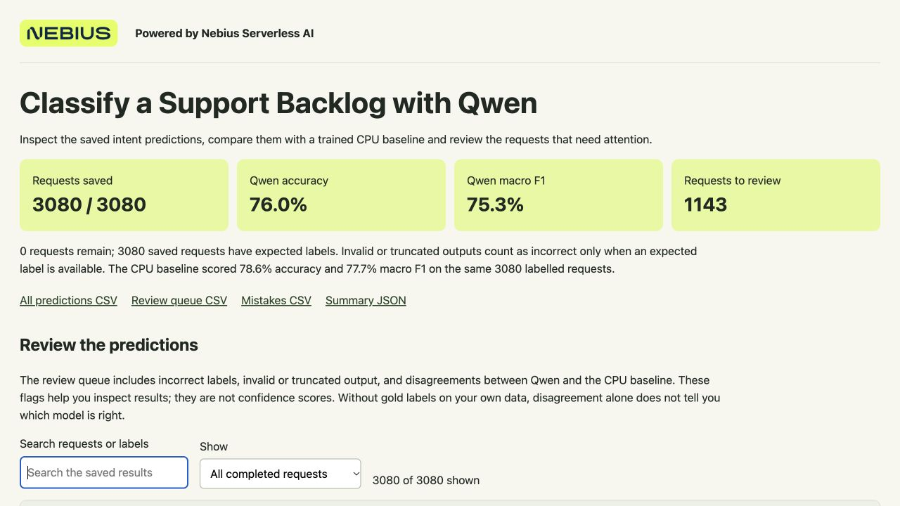

# Classify a Support Backlog with Qwen

Give Qwen a backlog of banking questions and get an intent-labeled CSV, a review queue and a browser report. The default run processes **3,080 human-authored BANKING77 examples across 77 intents**, so you can inspect both useful predictions and mistakes. This is a public benchmark, not production banking logs.

**Nebius Serverless AI runs the batch on a cloud GPU.** You'll create a **Job**: a container that loads Qwen, processes the backlog and exits. vLLM batches requests on the GPU; you don't need a local GPU, model API or server to keep running.

**Preemptible instances can give you a lower GPU rate when capacity is available.** Nebius can reclaim the GPU when capacity is needed elsewhere. A backlog can wait: this recipe saves every completed batch to Object Storage and resumes from those saved batches in a new Job. You may repeat the unfinished batch, but you keep completed work.

## What you need

- macOS or Ubuntu, Git and Python **3.10+**. No Docker or extra local Python packages.
- A Nebius account with billing enabled and a project in **eu-north1**. A project holds resources and their permissions.
- Permission to create Jobs and use Object Storage, plus quota for **one preemptible L40S**. Quota is your account's resource allowance; check **Quotas** in the console if deployment is refused.

## 1. Get the files

```bash
git clone https://github.com/MarouaneKhoukh/nebius-serverless-cookbooks.git
cd nebius-serverless-cookbooks/support-request-classification
python3 --version
```

Run the remaining commands from this directory.

<details>
<summary>Try the CPU baseline before renting a GPU</summary>

```bash
python3 scripts/run_baseline.py --output-dir results-cpu
```

This downloads the public dataset, fits a word/bigram Naive Bayes classifier on the training split and saves predictions for the test split. It needs no Nebius account. If its quality is enough for your task, you can use those results directly.

Qwen gets the request, the intent names and **one original training example per intent**: 77 examples showing how the labels are applied. This gives it an annotation policy in the prompt; Qwen isn't fine-tuned. The GPU experiment compares that approach with the CPU baseline on the same held-out requests. The baseline may still be the right choice for your task.

</details>

## 2. Sign in to Nebius

Install the CLI if needed:

```bash
curl -sSL https://artifacts.nebius.cloud/cli/install.sh | bash
```

Open a new terminal after installation and return to this directory. Use CLI **0.12.303 or newer**; run `nebius update` if yours is older.

Copy your eu-north1 project ID from the [Nebius console](https://console.nebius.com). Replace the whole `YOUR_PROJECT_ID` value below and complete the browser sign-in when prompted. If you already have a signed-in profile for this project, skip `profile create` and activate that profile's name instead.

```bash
export AI_AGENT="${AI_AGENT:-cookbook}"
nebius version
export NEBIUS_PROJECT_ID="YOUR_PROJECT_ID"
nebius profile create cookbook --parent-id "$NEBIUS_PROJECT_ID"
nebius profile activate cookbook
nebius iam whoami
```

Choose a **subnet**, the network your Job uses. It must allow outbound internet access to download the public model and dataset. Replace `YOUR_SUBNET_ID` with a subnet's `metadata.id`:

```bash
nebius vpc subnet list --parent-id "$NEBIUS_PROJECT_ID" --format json
export NEBIUS_SUBNET_ID="YOUR_SUBNET_ID"
```

If your project has no subnet, create one:

```bash
export NEBIUS_NETWORK_ID="$(nebius vpc network create --parent-id "$NEBIUS_PROJECT_ID" --name cookbook-network --format jsonpath='{.metadata.id}')"
export NEBIUS_SUBNET_ID="$(nebius vpc subnet create --parent-id "$NEBIUS_PROJECT_ID" --name cookbook-subnet --network-id "$NEBIUS_NETWORK_ID" --format jsonpath='{.metadata.id}')"
```

New networks have a default internet route. Use an approved subnet if your company manages networking.

## 3. Choose storage for results

In **Object Storage** in the console, select an existing bucket in this project and copy its ID. Or create a private bucket with the helper, replacing `support-backlog-results` with a unique bucket name:

```bash
python3 scripts/job.py create-bucket \
  --project-id "$NEBIUS_PROJECT_ID" --name support-backlog-results --yes
```

Copy the returned ID and replace the entire placeholder:

```bash
export NEBIUS_BUCKET_ID="YOUR_BUCKET_ID"
export RUN_ID="banking-backlog"
```

The bucket keeps completed batches and reports after the GPU stops. The helper's new bucket has a 10 GiB size limit; retained Object Storage is billed separately. Use a new run ID for different inputs or settings.

## 4. Run the batch

The [configuration](config/job.json) pins **Qwen/Qwen3-4B-Instruct-2507** to revision `cdbee75f17c01a7cc42f958dc650907174af0554`, with **vLLM 0.19.1**, one L40S with **16 vCPUs and 96 GiB host RAM**, a **100 GiB** temporary disk and a **one-hour timeout per Job**. The model is public; no Hugging Face token is needed.

Check the current rate under **Serverless AI → Jobs → Create job → Preemptible**. Nebius currently lists L40S preemptible instances at a [flat rate](https://nebius.com/prices); other GPU platforms use dynamic spot pricing. The helper supplies the CLI’s **Follow Spot price** setting without a cap. Budget for runtime download and model loading as well as processing: the GPU can be running before the worker starts.

Preview the configuration, then launch it:

```bash
python3 scripts/job.py submit \
  --project-id "$NEBIUS_PROJECT_ID" --subnet-id "$NEBIUS_SUBNET_ID" \
  --bucket-id "$NEBIUS_BUCKET_ID" --run-id "$RUN_ID" --dry-run

python3 scripts/job.py submit \
  --project-id "$NEBIUS_PROJECT_ID" --subnet-id "$NEBIUS_SUBNET_ID" \
  --bucket-id "$NEBIUS_BUCKET_ID" --run-id "$RUN_ID" --yes

python3 scripts/job.py wait --timeout 3600
python3 scripts/job.py logs --tail 30
```

If `wait` reports **FAILED / Preempted**, inspect the logs. A `result_published` event with `complete: true` can precede preemption: download and validate that archive before renting another GPU. If results are incomplete, use [Resume after an interruption](#resume-after-an-interruption).

The Job downloads verified, version-pinned BANKING77 files, runs Qwen on the **test split** in batches of **64** and saves each completed batch. Each prompt includes the same **77 short training examples**, one per intent, as labeling guidance. The model's weights stay unchanged. A separate word/bigram Naive Bayes baseline fits the **10,003 training examples**. Official test labels are used only for scoring; they are never supplied in Qwen's prompts.

For a smaller first check, add `--limit 32` to both submit commands and use a different run ID. That checks execution; it isn't a representative quality benchmark. Omit the limit, or use `--limit 0`, for all 3,080 examples.

<details>
<summary>Set a maximum GPU price</summary>

To supply a policy, create one for `gpu-l40s-d` under **Billing → Pricing → Pricing policy**, then add `--spot-pricing-policy-id "YOUR_POLICY_ID"` to both submit commands. L40S currently has a flat preemptible rate, so this recipe does not demonstrate price bidding. On platforms with dynamic pricing, an affordable maximum above the current rate leaves room for price changes and can improve allocation priority. A policy never guarantees capacity.

Choose the policy before launching. Stop Endpoints and finish or cancel Jobs using a policy before changing its maximum. A cap limits the GPU hourly rate, not total storage or repeated-run costs. [Pricing policies](https://docs.nebius.com/signup-billing/pricing-policy)

</details>

<details>
<summary>Build it with an agent instead</summary>

Install the [Nebius skills](https://github.com/nebius/skills#install) for your coding agent. It needs terminal access and the CLI sign-in from step 2. Then paste:

```text
Run support-request-classification in MarouaneKhoukh/nebius-serverless-cookbooks.
Use nebius-cloud-basics, nebius-serverless-jobs and
nebius-serverless-data-secrets with my authenticated CLI, project
<MY_PROJECT_ID>, subnet <MY_SUBNET_ID> and bucket <MY_BUCKET_ID>.
Follow the existing code and config/job.json. Show the current preemptible
L40S price and one-hour timeout; confirm before launching paid compute.
Process all 3,080 BANKING77 test examples, retrieve result.zip and run
scripts/check_result.py. Inspect predictions, errors and the trained CPU
baseline comparison. Verify this Job reaches a terminal state; cancel it
if needed. Keep credentials private and preserve results in the bucket.
```

</details>

## 5. Download and inspect the result

Look for the **`result_published`** event in the logs. It gives the exact object path:

```text
RUN_ID/exports/ATTEMPT_ID/result.zip
```

In **Object Storage → your bucket**, open that exact path and download `result.zip` to your Downloads folder. After a resume, use the new attempt's path. Validate and extract it into a new or empty directory:

```bash
python3 scripts/check_result.py "$HOME/Downloads/result.zip" --output results
```

Open **`results/report.html`** in your browser. For the full sample run, check that **3,080 of 3,080 requests are saved**. Compare Qwen with the CPU baseline on the same labeled requests, then use the review filter to inspect mistakes and disagreements.



**Powered by Nebius Serverless AI**

In the [recorded run](docs/sample-results/result.zip), Qwen classified **2,340/3,080 correctly (76.0%)**; the CPU baseline scored **2,420/3,080 (78.6%)**. The CPU baseline is the practical starting point for this dataset. The GPU path lets you examine few-shot inference and resumable batch execution; this run did not establish a quality or cost advantage for it.

The ZIP includes:

- **`predictions.csv`** — requests, predicted intents, baseline predictions and scoring flags.
- **`review.csv`** — wrong, invalid or truncated outputs and model/baseline disagreements. These flags are review cues, not confidence scores.
- **`mistakes.csv`** — wrong or failed predictions with available expected labels.
- **`summary.json`** — completeness, accuracy, macro F1, per-intent results and run metadata.
- Input, dataset provenance, runtime configuration and attempt records for reproduction.

Accuracy is an observation from your run, not a promised result. Worker timers exclude provisioning and image pull; they are not a billing measurement. See [validation notes](VALIDATION.md) for the recorded configuration, results and recovery checks.

## 6. Check that compute has stopped

```bash
python3 scripts/job.py status
```

A completed Job releases its GPU and temporary disk automatically. If you no longer need an active Job, cancel it and check its final state:

```bash
python3 scripts/job.py cancel --yes
python3 scripts/job.py status
```

Keep the bucket while you need its saved batches and reports. To remove storage charges later, delete only this run's objects or a dedicated recipe bucket in the console; don't remove shared data.

## Resume after an interruption

Preemption does **not** trigger an automatic Job restart. First validate any exported archive: complete results need no new Job. If work remains, wait for the previous attempt to become terminal and for capacity to be available, then resume the tracked run:

```bash
python3 scripts/job.py resume --dry-run
python3 scripts/job.py resume --yes
python3 scripts/job.py wait --timeout 3600
python3 scripts/job.py logs --tail 30
```

The new Job loads verified batches from the same bucket and processes only missing batches. Keep `.state/job.json`, the original files, input and settings. A partly generated batch may run again; starting another attempt incurs new loading and compute time. Download the new attempt's ZIP using its `result_published` path.

To try a planned recovery test, use a new run ID and add `--stop-after-batches 2` to both initial submit commands. That Job exits after two saved batches. Use the resume commands above, then validate the final archive with:

```bash
python3 scripts/check_result.py "$HOME/Downloads/result.zip" --output results-recovery --require-resume
```

This checks deliberate resumption; it doesn't demonstrate a natural GPU reclaim.

## Use your own banking requests

Create a UTF-8 CSV with unique IDs and request text:

```csv
id,prompt
request-001,My card payment is still pending
```

An optional `expected` column enables accuracy and mistake reporting. Without it, the tool still exports predictions and review disagreements, but doesn't invent accuracy. Expected values must use the exact [BANKING77 intent names](https://github.com/PolyAI-LDN/task-specific-datasets/blob/57ec275d8078af65b7731c2a98be812d844a6d6b/banking_data/categories.json).

Upload the CSV in the console to **your bucket → `inputs/backlog.csv`**. Use a new run ID, and add **`--input-key inputs/backlog.csv`** to both submit commands in step 4. The Job reads that object and writes reports to the new run's folder. Keep the object unchanged when resuming.

The classifier and CPU baseline use these same 77 banking intents. Another domain needs a different taxonomy, prompt and baseline training data; replacing the CSV alone doesn't make this a general support classifier.

This is a closed-set classifier: unfamiliar requests still receive one of the allowed intents. Review its suggestions before using them for automatic routing.

## If something fails

- **Quota or no capacity:** check your quota, then retry when preemptible L40S capacity is available.
- **Long `STARTING` or no progress:** inspect bounded logs with `python3 scripts/job.py logs --tail 100`. Check image/network access; cancel unused compute while diagnosing.
- **Wait timed out:** the Job may still be running. Check status and cancel it if you aren't continuing.
- **Changed input/configuration:** choose a new run ID; don't mix incompatible results.
- **Request exceeds context:** shorten that request before starting a new run.

Local checks, without creating cloud resources:

```bash
python3 -m unittest discover -s tests -v
```

[BANKING77 source and CC BY 4.0 license](data/SOURCE.md) · [Model card](https://huggingface.co/Qwen/Qwen3-4B-Instruct-2507) · [Serverless Jobs](https://docs.nebius.com/serverless/jobs/manage) · [Job recovery limits](https://docs.nebius.com/serverless/jobs/auto-restarts)
